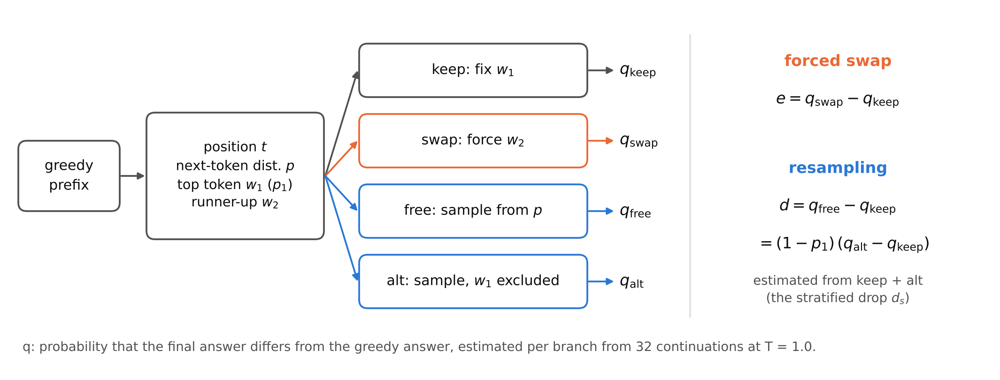
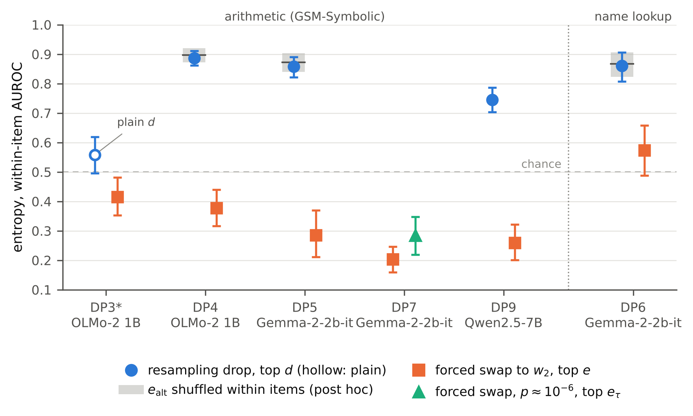
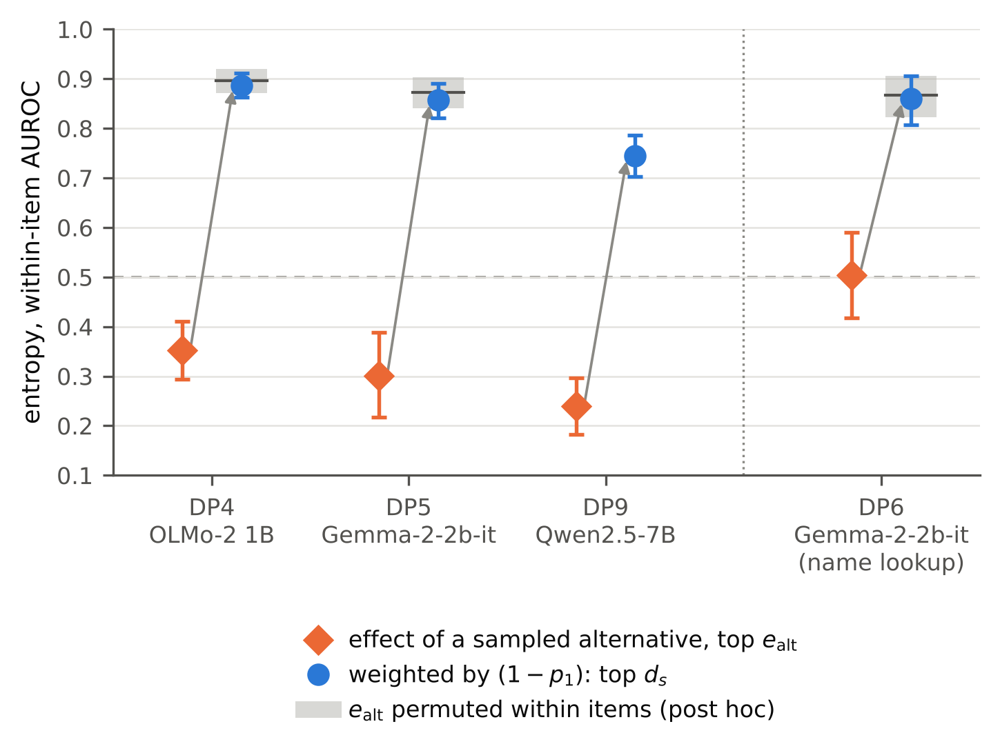
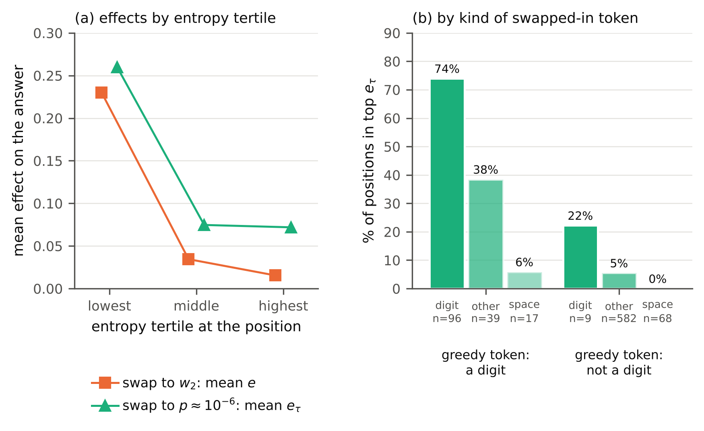
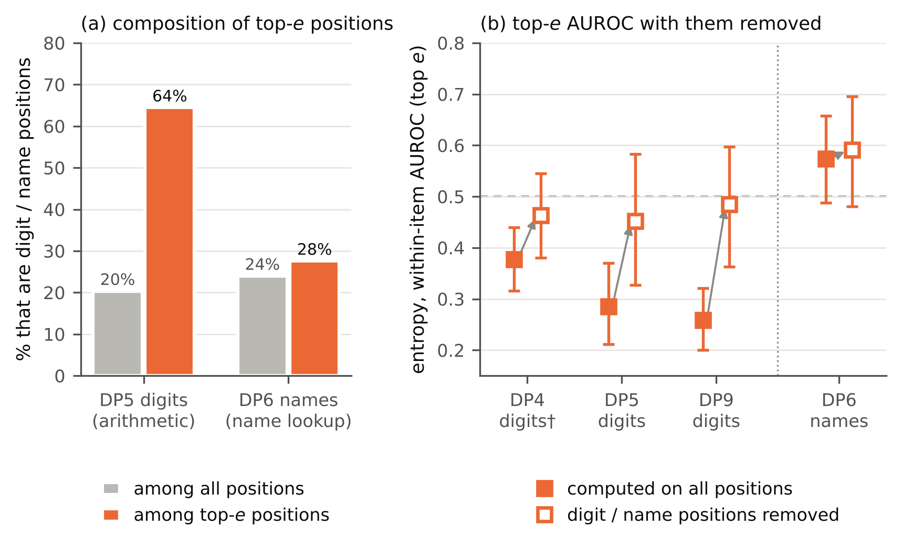
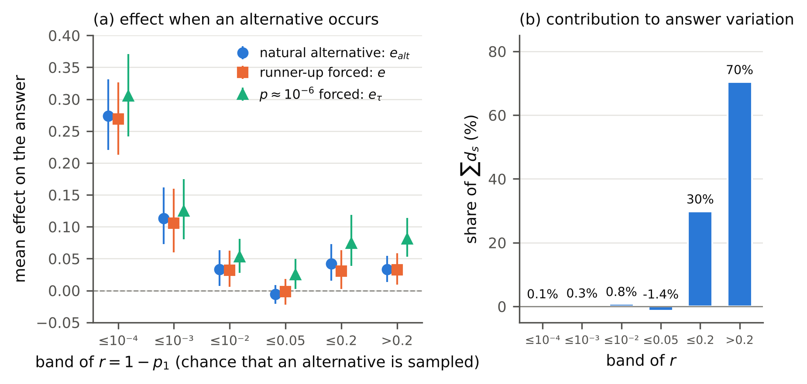

<!--
English draft, rev. 9 (2026-11-01). Revision history, kept for transparency:
rev. 1 (2026-10-09): after an independent fact-check.
rev. 2: after a five-reviewer round (notes/paper_review_round1.md).
rev. 3: R1 (post hoc, frozen plan, notes/r1_result.md) and DP7 (pre-registered probability-matched swap,
notes/dp7_result.md) added; restructured claim-first for outside readers (abstract without experiment IDs,
experiments table, decision-rule appendix, CT-1 moved to Appendix C).
rev. 4 (2026-10-13): the closed-model study (CR-1 stopped at G1; CR-1a INSUFFICIENT_FORK_SIGNAL) and the
replacement-type analysis on its data (PARA-1a) added as Appendix D, with one Discussion paragraph and a pointer
paragraph in Appendix B, as the CR-1 gate's [decision 5 = C] requires whatever the outcome; checked against the
sources by a separate agent (2026-10-13) and corrected. Sources: notes/cr1_claude_resample_gate.md,
notes/cr1_g1_result.md, notes/cr1a_amendment.md, notes/cr1a_g3_result.md (reports/cr1a_g3_result.json),
notes/para1a_amendment.md, notes/para1a_partA_result.md (reports/para1a_partA_result.json),
notes/para1a_explore_ws_result.md (reports/para1a_explore_ws_result.json).
rev. 5 (2026-10-16): the rarity bridge added as §3.5 (DP8-X, post hoc: notes/dp8x_result.md, reports/dp8x_result.json;
DP8, pre-registered: notes/dp8_rarity_bridge_gate.md, notes/dp8_result.md, reports/dp8_*.json) with Figure 6, an
abstract bullet, a finding, Table 1 rows, Appendix B rows and Discussion/Limitations text; the old §3.5 is now §3.6;
the closed-model series CR-2 to CR-5 added as Appendix E (notes/decision_points_cr2_cr5_synthesis.md and the
per-experiment notes notes/cr2_g3_result.md, notes/cr3_result.md, notes/cr4_result.md, notes/cr5_result.md).
Checked against the sources by a separate agent (2026-10-16): 3 errors, 1 missing reference, 6 overstatements
and nits corrected (wording now marks the cross-definition reading and the CR-5 correspondence as interpretation).
Sources: per-experiment result notes (notes/dp1_*.md … notes/dp8_result.md, notes/r1_result.md, notes/ct1_result.md),
reports/dp3_*.json … reports/dp8_*.json, reports/r1_RESULT.json, notes/appendix_stratified_drop.md.
Citations: author–year in the text; full entries in the References section and paper/refs.bib (verified
2026-10-09; see notes/dp2_related_work.md and the comments in refs.bib for open checks).
rev. 6 (2026-10-17): the Japanese check JP-1 (Sarashina2.2-1B, Japanese MGSM, 20 items, Japanese only) added as
Appendix F, with one Discussion paragraph, one Limitations item and a pointer in Appendix B; outside the claims.
Sources: notes/jp1_sarashina_gate.md (frozen 3198152), notes/jp1_amendment1.md, notes/jp1_amendment2.md,
notes/jp1_after_freeze.md (sections from "本番 日本語A の結果" to "日本語A だけの分析の結果"), Dropbox
/stash/jp1/analysis/JP1_JA_ONLY_RESULT.json (result_sha256 53f9a1e5…).
rev. 7 (2026-10-18): the pre-registered replication on a larger model of a third family (DP9, Qwen2.5-7B-Instruct,
40 new items) added as §3.6 (the old §3.6 is now §3.7) with a new Table 7 (old Tables 7–11 renumbered 8–12),
abstract ranges, findings, Table 1/2/3 rows, DP9 points in Figures 2, 3 and 5b, a digit bullet in §3.3, Discussion/Limitations text, Appendix A (numerics) and
Appendix B rows. Sources: notes/dp9_qwen7b_replication_gate.md (frozen 241a3f6), notes/dp9_result.md,
reports/dp9_RESULT.json (result_sha256 b791a04c…), reports/dp9_AUDIT.json, reports/dp9_FINAL.json.
Checked against the sources by a separate agent (2026-10-18): 2 numeric errors (DP7's match rate, a rounding),
scope and causal overstatements, and nits corrected; the gate's contamination and attention/batching limits added.
rev. 8 (2026-10-18): restructured after an outside reader's review (no new results): abstract cut to ~260 words and
led by the digit finding; introduction findings cut to four; registered label strings kept only in Appendix B
(the main text states outcomes in words; Appendices C–G keep theirs); old §3.7 (DP1, DP2) moved to Appendix G
with an "Origins" note in §2; §3.6 condensed and its table dropped (its rows are in Table 8); old Tables 8–12
renumbered 7–11; DP3's control and DP6's gate history moved to Appendix B; Discussion of Appendices D–F cut to one
paragraph (the CR-1 gate's decision 5 still met: appendix plus one main-text paragraph); PARA-1a condensed with a
pointer to its notes; CT-1 dropped from the contributions but kept in Appendix C; claim fixes (digit-position
equivalence caveat, the |d_s| ≤ r bound, off-policyness wording) and two limitations (headroom, temperature).
rev. 8 addendum (2026-10-18): the post hoc headroom check HR-1 (notes/hr1_headroom_plan.md, frozen a3aa298;
notes/hr1_result.md; reports/hr1_RESULT.json, result_sha256 7ad6f069…) added to §3.1's robustness list, replacing
the Headroom limitation.
rev. 8 addendum 2 (2026-10-18): the post hoc rank check RK-1 (notes/rk1_tau_rank_plan.md, frozen 2026-10-18 17:41
JST; notes/rk1_result.md; reports/rk1_RESULT.json, result_sha256 d17d32f5…) added to §3.3, the Discussion's
off-policyness sentence and two limitations. The exploratory feature sweep EX-1 (notes/ex1_feature_sweep_spec.md,
frozen 17:49 JST; notes/ex1_result.md; reports/ex1_RESULT.json, result_sha256 dfdd580c…) added as Appendix H
(Tables 12–13) with one paragraph in §3.3, at the owner's decision (2026-10-18 18:50 JST).
Checked against rev. 7 and the sources by a separate agent (2026-10-18): 3 errors in condensed text (PARA-1a's
spelling type and item means; CR-1 versus CR-1a), lost caveats restored (post hoc, stratified, CR-4's hidden
forks, CR-1a's whitespace check, DP9's d_plain), wording and cross-references corrected.
rev. 9 (2026-11-01): abstract aligned with the findings list before the public release (no new results): "mostly
pre-registered" (R1, HR-1, RK-1, EX-1 and the shuffle baseline are post hoc); the opposite directions stated as
entropy's relation to the two definitions, on these models; "a substantial part of the pattern, not all of it" and
"confirmed under pre-registration in four" carried over from Finding 1.
Scope rule: claims stay within OLMo-2 1B / Gemma-2-2b-it / Qwen2.5-7B-Instruct (DP9 only), GSM-Symbolic (plus
the DP6 name-lookup check, Gemma only), these definitions — except Appendices D and E (Claude Haiku 4.5) and F
(Sarashina2.2-1B, Japanese), which are reported separately and are not part of the claims.
-->

# Which forks? The definition of a forking token can flip its relation to entropy

## Abstract

Token-level entropy is widely used to find the "forking tokens" of chain-of-thought reasoning: positions where a
different choice would change the outcome. A fork can be measured by forcing an alternative token (a *forced
swap*) or by *resampling* from the position. We measure both at the same positions, in a series of mostly
pre-registered experiments with replay audits, on GSM-Symbolic arithmetic with three open models (OLMo-2 1B, Gemma-2-2b-it and
Qwen2.5-7B-Instruct). On these models, entropy relates to the two definitions in opposite directions. Large
forced-swap effects concentrate on confident, answer-bearing digit tokens (a substantial part of the pattern, not
all of it), so entropy points away from them (within-item AUROC 0.20–0.42 in five experiments; confirmed under
pre-registration in four). In Gemma this persisted when the swapped-in token's probability was held near 10⁻⁶, so it is not
only an effect of swapping in improbable tokens. Large resampling drops, estimated with a stratified estimator,
align with entropy (0.75–0.89), but largely by construction: the drop factors exactly as (1 − p₁)(q_alt − q_keep),
and keeping each position's 1 − p₁ while shuffling the effects reproduces the alignment (post hoc, in the two
smaller models). The same identity gives a lower-variance estimator
of the drop. The two views meet at rare alternatives: in Gemma, an alternative the model itself samples at a
confident position was about as damaging as a forced one, but such positions contributed almost nothing to how
sampled answers vary. On a synthetic name-lookup task (Gemma, one hop) the anti-alignment did not appear. In the 7B model, six of seven
pre-registered tests came out as predicted; the resampling side was only weakly measured there, and the test of
rare positions was undecided. Studies that use entropy as a forking signal should state which definition they
need and report answer-bearing tokens separately.

## 1 Introduction

High-entropy tokens have been proposed as the "forks" of reasoning: the minority of positions where the model
hesitates, and where training signal or analysis should concentrate (Wang et al., 2025; Cheng et al., 2026).
Direct tests of whether such positions change outcomes use two operationalisations:

- **Forced swap.** Replace the chosen token with an alternative (typically the runner-up) and check whether
  the answer changes (Ruan et al., 2025; at the sentence level, off-policy edits in Macar et al., 2026).
- **Resampling.** Sample the token and its continuation from a prefix and measure how the answer
  distribution moves (at the sentence level, Bogdan et al., 2025; Macar et al., 2026). Forking Paths
  (Bigelow et al., 2025) combines the two: it forces each probable alternative token, samples continuations
  after it, and weights the outcomes by the token's probability.

A forced swap asks *"what if this token were different?"*, ignoring how likely that is. Resampling asks
*"does the outcome actually branch here?"*, which combines the effect of an alternative with the chance of
sampling one. We show that on arithmetic this difference reverses the direction of entropy's relation to
forks, and we take the reversal apart. One half of it is built into the resampling definition. The other half is
the empirical finding: forced-swap effects concentrate on confident, answer-bearing digit tokens. That digits
matter in arithmetic is not surprising; what matters for entropy-based methods is that, under one definition,
selecting tokens by entropy systematically passes over them.

**Findings.**

1. **Forced-swap effects sit at confident digit tokens (§3.1, §3.3).** Entropy is anti-aligned with these
   effects in all five arithmetic experiments, and the anti-alignment was confirmed under pre-registration in four, on three
   models (1.5B to 7.6B parameters, three families). Digit tokens carry a substantial part of it, not all. In Gemma it persisted when
   the probability of the swapped-in token was fixed at about 10⁻⁶ at every position, although the matched token
   at a digit position was often itself a digit. On a synthetic name-lookup task it did not appear (§3.4), so it
   may be specific to arithmetic.
2. **The resampling side is largely built in (§3.2).** The resampling drop factors exactly into the chance that
   an alternative is sampled, 1 − p₁, times the effect of an alternative. A baseline that keeps 1 − p₁ and
   shuffles the effects within items reproduces entropy's alignment with the drop (post hoc). That alignment is
   largely a property of the definition, not a finding about where reasoning branches.
3. **Rare alternatives (§3.5).** In Gemma, an alternative that the model itself samples was about as damaging as
   the forced runner-up, and most damaging where alternatives are rarest; but such positions contributed almost
   nothing to how the answer varies under sampling. Our reading (an interpretation, not a registered test) is that
   the two definitions look at the same positions from opposite sides.
4. **A larger model of a third family (§3.6).** In Qwen2.5-7B-Instruct the anti-alignment, the weighting, the
   digit concentration and the first two rarity results replicated under the original decision rules. The
   alignment with the resampling drop was confirmed under a new rule but only weakly measured, probably because
   that model leaves almost no drop at most positions. Whether rare positions contribute little was undecided, and
   the probability-matched swap was made descriptive before the run (a smoke run had found a token near 10⁻⁶ at
   only 47% of positions).

**Contributions.** (a) A same-position, within-item comparison of entropy against both fork definitions (five
experiments, three model families), within a series of ten pre-registered experiments with frozen decision rules
and replay audits; every registered test and its outcome, including negative results such as a transcoder study
(Appendix C), is listed in Appendix B. (b) An exact decomposition that explains the resampling side and a
weight-only baseline that shows how much of it is built in. (c) A probability-matched swap that separates "the
model is confident here" from "the swapped-in token is improbable". (d) A same-position comparison of natural
and forced alternatives across bands of rarity, which separates the size of an effect from its contribution to
answer variation. (e) A practical tool: a stratified estimator of the resampling drop that makes per-position
estimates usable at feasible sample sizes.

## 2 Setup

**Models.**
- OLMo-2 1B (`allenai/OLMo-2-0425-1B-Instruct`; Team OLMo et al., 2025; fixed revision, float16).
- Gemma-2-2b-it (`google/gemma-2-2b-it`; Gemma Team, 2024; fixed revision, bfloat16, eager attention).
- Qwen2.5-7B-Instruct (`Qwen/Qwen2.5-7B-Instruct`; Qwen Team, 2024; fixed revision, bfloat16, PyTorch's
  scaled-dot-product attention), used only in the replication DP9 (§3.6). Its own chat template, which inserts a
  default system message, is used unchanged.

**Data.** GSM-Symbolic (Mirzadeh et al., 2025). Each experiment uses items not used in any earlier experiment
of this series, except one transcoder study (CT-1, Table 1), which reused the items of a resampling experiment
(DP2) by design. Earlier draws are reconstructed and excluded before any token is generated. Templates may
repeat across experiments. One experiment (DP6) instead uses a synthetic name-lookup task (§3.4).

**Experiments.** Table 1 lists the experiments. We refer to them by their short names; the results are
organised by claim, not by experiment.

| Name | Model | Items run / analysed | What it measures | Status |
|---|---|---|---|---|
| DP1 | OLMo-2 1B | 100 / 100 | forced-swap forks (greedy continuation) | pre-registered |
| DP2 | OLMo-2 1B | 60 / 60 | resampling forks over 8-token windows | pre-registered |
| DP3 | OLMo-2 1B | 40 / 39 | both definitions at the same positions; digits | pre-registered |
| CT-1 | Gemma-2-2b-it | DP2's items (56 pairs) | transcoder explanation of forks (Appendix C) | pre-registered |
| DP4 | OLMo-2 1B | 40 / 40 | both definitions, stratified drop | pre-registered |
| DP5 | Gemma-2-2b-it | 40 / 39 | replication on a second model; digit source | pre-registered |
| DP6 | Gemma-2-2b-it | 40 / 40 | name lookup instead of arithmetic | pre-registered |
| R1 | — | records of DP3–DP6 | weight-only baseline, swap size, readout, robustness | post hoc (frozen plan) |
| DP7 | Gemma-2-2b-it | 40 / 39 | probability-matched forced swap | pre-registered |
| DP8-X | — | records of DP4, DP5, DP7 | effects of natural and forced alternatives by rarity | post hoc (views fixed in advance) |
| DP8 | Gemma-2-2b-it | 40 / 38 | natural versus forced alternatives by rarity | pre-registered |
| DP9 | Qwen2.5-7B-Instruct | 40 / 39 | replication of DP5 and DP8 on a larger model of a third family | pre-registered |

**Table 1.** The experiments, in the order they were run (the closed-model studies of Appendices D and E and the
Japanese check of Appendix F are not listed).

**Base path.** Greedy decoding (ties to the lower token id), at most 512 tokens. The answer is taken from the
final-answer line, falling back to the last number (DP6: a name read from the final-answer line); numbers are
compared exactly. Items whose base answer cannot be read are excluded. We analyse positions before the first
answer token a (the token that contains the first character of the answer): in DP3–DP9, every 4th (DP3), 6th
(DP4) or 8th (DP5–DP9) token from the start of the response. A *digit position* is one whose base-path token
contains a digit.

**Fork quantities (Figure 1).** At position t, let w₁ be the top token (with probability p₁) and w₂ the
runner-up (p₂). We fix the token at t and sample K continuations at temperature 1.0 (K = 32 in DP3–DP9). Let q
be the fraction of continuations whose answer differs from the base answer; an unreadable answer counts as
different.

- *Forced-swap effect*: e(t) = q_swap(t) − q_keep(t), with the token at t fixed to w₂ versus w₁.
- *Probability-matched swap effect (DP7)*: e_τ(t) = q_swapτ(t) − q_keep(t), with the token at t fixed to w_τ,
  the token whose probability at t is closest to τ = 10⁻⁶ in log space (w₁, end-of-sequence and special tokens
  excluded; w₂ allowed; ties to the lower id). A position is *matched* if p(w_τ) lies within ±0.5 decades of τ.
- *Forced fork (DP1, DP3)*: the single greedy continuation after the swap changes the answer.
- *Resampling drop*: d(t) = q_free(t) − q_keep(t), where "free" also samples the token at t. d is how much
  the chance of a changed answer falls once the token at t is fixed to the greedy choice, that is, how much of
  the outcome is decided at t. DP2 uses a window version, q(t) − q(t+8), with 16 samples.

**Stratified drop.** Sampling the token at t from the model's own distribution gives exactly

  q_free = p₁·q_keep + (1 − p₁)·q_alt,  so  d = (1 − p₁)(q_alt − q_keep),

where q_alt samples the token at t with w₁ removed and the rest renormalised. The identity holds for the
underlying probabilities, up to numerical differences between the logits used for p₁ and those used for
sampling (Appendix A).

- d_s = (1 − p₁)·e_alt, with e_alt = q_alt − q_keep (the effect of replacing w₁ by a sampled alternative), is
  unbiased for d.
- p₁ is read off the logits rather than sampled, so the variance of d_s is (1 − p₁)² times that of the
  estimated e_alt. Its standard deviation shrinks in proportion to 1 − p₁ at confident positions; that of the
  plain estimate does not.
- It needs the same number of samples as the plain estimate (keep + alt instead of keep + free).

Conditioning on the first token and reweighting follows Forking Paths (Bigelow et al., 2025), whose outcome
distribution is a mixture over alternative tokens weighted by their probabilities; d_s is its two-group case
(the greedy token versus all others). Using the exact probability of the greedy category instead of sampling
which category occurs is a form of Rao–Blackwellization (cf. Liu et al., 2019). More generally, Re et al.
(2026) use the next-token distributions available during sampling to reduce the variance of expectation
estimates under language models; the stratified drop applies this idea at a single position with two strata.
The identity itself is an application of the law of total expectation. At the sentence level, Thought Anchors
makes the analogous split between resampling importance and counterfactual importance (Bogdan et al., 2025).
We claim no novelty for any of these, only for using the (1 − p₁) factor to explain the entropy relation
(Appendix A).

**Figure 1.** The two definitions of a forking token. At position t of the greedy path, the token is fixed to
the top token w₁ (keep) or to the runner-up w₂ (swap), or it is sampled from the model's distribution, either
in full (free) or with w₁ excluded (alt). Each q is the probability that the final answer differs from the
greedy answer, estimated from 32 continuations at temperature 1.0 (DP3–DP9). The forced-swap effect e compares
swap with keep; the resampling drop d compares free with keep, and the identity on the right holds for these
probabilities. DP3 ran keep, swap and free and used the plain estimate of d. DP4–DP6 ran keep, swap and alt at
every position and rank positions by the stratified drop d_s, estimated from keep and alt; free was run only to
check this estimator and its noise (at every position in DP4, at every third position in DP5 and DP6). DP7 ran
keep, swap and a third forced swap to a token of probability about 10⁻⁶ (not shown); DP8 ran keep, swap, alt and
that swap at every position (§3.5); DP9 ran the same four at every position and free at every third (§3.6).

**Evaluation.**
- Labels are the top 15% of all positions in an experiment (pooled across items) by e, e_τ, d (DP3), e_alt or
  d_s; in DP7, among matched positions only. Ties at the cut are broken by item order, then position.
- The score is the next-token entropy at t in nats, computed from the temperature-1.0 distribution that is
  sampled from (after soft-capping for Gemma).
- We report the within-item AUROC: computed per item that has both classes, then averaged with equal weight
  per item. Items with no labelled position (or only labelled positions) drop out, so each estimate rests on
  fewer items than were run (for example 36 of 39 for top e in DP5), and a difference between two AUROCs can
  average over slightly different sets of items.
- CIs are 95% percentile bootstrap intervals with 2,000 resamples of templates, labels held fixed; DP3–DP5,
  DP7–DP9 drew one item per template, and DP6 resamples items (each has its own roster). Differences use the
  same resamples. Intervals are per comparison and not adjusted for multiple comparisons.
- DP8 does not label positions. Its tests are position-weighted mean differences, a ratio of sums and a mean
  within-item Spearman correlation (§3.5), with intervals from the same item bootstrap; items whose base answer
  cannot be read have no positions and enter only the base accuracy. DP9 repeats DP5's labelled tests and DP8's
  first three tests with the same definitions, and adds one new test (§3.6).

**Pre-registration and audit.**
- Each confirmatory experiment (DP1–DP9 and CT-1) had a gate document fixing definitions, seeds, labels and
  decision thresholds. It was frozen and hashed before running. Appendix B lists every decision rule and its
  outcome.
- R1 is a set of post hoc analyses of existing records, run from a plan frozen before computing them; we label
  its results "post hoc". Other exploratory analyses (DP1-X, DP1-X2, DP2-X1, DP2-X2, the DP2 side analyses and
  DP3-X1, DP8-X; described in Appendix B) are also marked post hoc. Analyses that a gate lists as secondary but without a decision rule are
  called pre-specified secondary analyses.
- After each confirmatory run, a replay audit regenerated a pre-declared subset of outputs with reference
  implementations: base paths, continuations or samples on 5–10 items (in DP7–DP9 also the choice of w_τ,
  in DP8 and DP9 also the first token of alt, in DP9 also free). Every audit matched (0 diverged items).
- In the main text we state each registered outcome in words (confirmed, not confirmed, not replicated or
  undecided under its rule). The frozen rules and the registered outcome labels are listed in Appendix B (Table 8). "Label" in the
  main text always means membership in the top 15% of positions.

**Origins.** The series began with one definition per experiment on OLMo-2 1B: forced swaps (DP1) and resampling
over 8-token windows (DP2). Within items, entropy was anti-aligned with forced-swap forks (post hoc) and moderately
aligned with resampling forks, and a post hoc look at DP1's records suggested that weighting by the runner-up's
probability nearly reproduced the gap. These observations motivated DP3–DP5 (Appendix G).

## 3 Results

### 3.1 Forced-swap effects are anti-aligned with entropy on arithmetic

At the same positions, entropy's within-item AUROC for the top 15% of forced-swap effects lies below 0.5 in
every arithmetic experiment (Table 2, Figure 2). Comparing it with 0.5 was a registered test in DP4, DP5, DP7
(where the runner-up swap was the prerequisite test) and DP9, and post hoc in DP3.

| Experiment | Model, items analysed | Positions | Entropy AUROC, top e | Entropy AUROC, top resampling drop |
|---|---|---|---|---|
| DP3 | OLMo-2 1B, 39 | 1,692 | 0.415 [0.353, 0.482] | 0.558 [0.495, 0.620] (plain d) |
| DP4 | OLMo-2 1B, 40 | 1,046 | 0.378 [0.316, 0.440] | 0.887 [0.862, 0.911] (d_s) |
| DP5 | Gemma-2-2b-it, 39 | 905 | 0.286 [0.211, 0.370] | 0.858 [0.821, 0.891] (d_s) |
| DP7 | Gemma-2-2b-it, 39 | 811 (matched) | 0.203 [0.160, 0.246] | — (not measured) |
| DP9 (§3.6) | Qwen2.5-7B-Instruct, 39 | 1,324 | 0.259 [0.200, 0.321] | 0.745 [0.703, 0.786] (d_s) |
| DP6 (name lookup, §3.4) | Gemma-2-2b-it, 40 | 388 | 0.574 [0.488, 0.658] | 0.860 [0.807, 0.906] (d_s) |

**Table 2.** Entropy's within-item AUROC under each definition, with 95% CIs. Registered outcomes for top e:
anti-alignment confirmed in DP4, DP5, DP7 and DP9, not replicated in DP6. For top d_s, alignment was a
registered test only in DP9 (confirmed); in DP4–DP6 this value entered only the weighting test.

**Figure 2.** Entropy's within-item AUROC for the top 15% of positions under each definition (Table 2).
*DP3: comparing either side with 0.5 was post hoc; DP3 is where the anti-alignment was first separated from
chance. Blue circles: resampling drop (hollow: plain estimate of d, DP3; filled: stratified d_s). Grey bands:
the same AUROC when each item's e_alt is shuffled across its positions while 1 − p₁ is kept (post hoc, R1;
band = 95% range of 2,000 shuffles, line = mean; R1 predates DP9, so DP9 has no band). Orange squares: forced swap
to the runner-up (top e). Green triangle: forced swap to a token of probability about 10⁻⁶ (top e_τ, DP7, matched
positions). DP9 is Qwen2.5-7B-Instruct (§3.6). Vertical bars are 95% bootstrap intervals (template-level;
item-level in DP6); the dashed line is chance.

- On arithmetic (DP3–DP5, DP7, DP9) every forced-swap interval lies below 0.5. In the name-lookup check (DP6) the
  forced-swap side is indistinguishable from 0.5, while the resampling side is far above it.
- The anti-alignment was first separated from chance in DP3 (post hoc: 0.415 against a within-item
  permutation null of mean 0.500, two-sided p = 0.0025); DP3's registered control is discussed in Appendix B.

**Robustness (post hoc, R1, and pre-specified secondary analyses of DP7).**
- *Threshold.* Labelling the top 5, 10, 20, 30 or 50% instead of 15% leaves every arithmetic point estimate
  (DP3–DP5, DP7)
  below 0.5, and the anti-alignment roughly grows as the cut tightens (DP5: 0.194 [0.115, 0.295] at 5% and 0.403
  [0.343, 0.465] at 50%; DP7, top e_τ: 0.177 [0.105, 0.264] and 0.427 [0.375, 0.479]). The only interval that
  reaches 0.5 is DP3's at 50% ([0.418, 0.504]).
- *No labels.* The mean within-item Spearman correlation between entropy and e is −0.092 [−0.148, −0.038]
  (DP3), −0.149 [−0.226, −0.067] (DP4) and −0.214 [−0.278, −0.150] (DP5), all outside within-item
  permutation nulls centred near 0; in DP7 it is −0.268 for e and −0.195 for e_τ (permutation 95% ranges about
  ±0.08).
- *Ties and unreadable answers.* Breaking ties at the cut at random, or counting unreadable continuations as
  unchanged or dropping them instead of counting them as changed, moves the AUROCs by about 0.03 at most; for
  the answer-format variants every arithmetic interval stays below 0.5. Unreadable answers are rare (0–3.5% of
  continuations).
- *Reliability.* The labels are stable: in DP7 the split-half correlation of e is 0.854 and of e_τ 0.876.
- *Headroom (post hoc, HR-1, plan frozen before computing).* A forced swap can raise the chance of a changed answer
  by at most 1 − q_keep, so if q_keep rose with entropy within items, headroom alone could produce
  anti-alignment. It did not: within items, entropy and q_keep were essentially uncorrelated (mean Spearman
  between −0.011 and +0.068, every interval including 0; DP4, DP5, DP7, DP9). Dividing e by 1 − q_keep, or keeping
  only positions with q_keep ≤ 0.5, left every interval below 0.5 (DP4 0.348 and 0.335, DP5 0.234 and 0.280, DP7
  0.189 and 0.149, DP9 0.260 and 0.238; upper ends 0.418 at most), so the anti-alignment is not a headroom effect.

**Pre-specified secondary analyses: solved versus unsolved items.** The anti-alignment is strongest on items
the model solves. Entropy's AUROC for top e on solved versus unsolved items is 0.343 [0.211, 0.497] versus
0.456 [0.401, 0.508] (DP3), 0.320 [0.238, 0.396] versus 0.442 [0.353, 0.539] (DP4), 0.151 [0.098, 0.214]
versus 0.420 [0.303, 0.547] (DP5), 0.139 [0.098, 0.183] versus 0.289 [0.224, 0.346] (DP7) and 0.247 [0.180,
0.318] versus 0.337 [0.286, 0.399] (DP9, where only 5 items were unsolved). On unsolved items the interval
includes 0.5 in DP3 (only just), DP4 and DP5, but not in DP7 or DP9. One reason for the gap is mechanical:
e ≤ 1 − q_keep, and q_keep tends to be high on unsolved items (on DP1's records, mean 0.64 versus 0.15 on
solved items; post hoc).

### 3.2 The resampling side's alignment largely follows from the definition

**The weighting test (pre-registered).** By the identity, d_s = (1 − p₁)·e_alt. The weighting tests compare
entropy's AUROC for top d_s with that for top e_alt at the same positions (Table 3, Figure 3).

| | DP4 OLMo-2 1B | DP5 Gemma-2-2b-it | DP9 Qwen2.5-7B-Instruct | DP6 Gemma-2-2b-it (name lookup) |
|---|---|---|---|---|
| Entropy AUROC, top d_s | 0.887 | 0.858 | 0.745 | 0.860 |
| Entropy AUROC, top e_alt | 0.352 | 0.301 | 0.239 | 0.505 |
| Difference | +0.535 [0.465, 0.604] | +0.557 [0.465, 0.649] | +0.506 [0.438, 0.570] | +0.356 [0.260, 0.447] |
| Registered outcome | confirmed | confirmed | confirmed | confirmed |
| Estimator check, mean(d_s − d_plain) | 0.00001 [−0.0055, +0.0056] | −0.0027 [−0.0121, +0.0071] | −0.0002 [−0.0039, +0.0037] | −0.0013 [−0.0138, +0.0112] |
| Weight-only baseline, mean [95% range] (post hoc, R1) | 0.897 [0.872, 0.920] | 0.873 [0.840, 0.904] | not computed | 0.868 [0.823, 0.906] |

**Table 3.** The weighting tests (pre-registered) and the weight-only baseline (post hoc; R1 predates DP9).

Multiplying by (1 − p₁) turns an anti-aligned quantity (e_alt) into a strongly aligned one (d_s). In DP3,
which used the plain estimator, the difference (top d minus top e) was +0.143 [0.035, 0.245], in the predicted
direction but short of the registered margin of 0.05 (undecided under its rule); its labels were too noisy (see
*Measurement*, below).

**How much is built in.** A positive result was expected in advance. A power simulation written while DP4 was
running, before any results were seen (Appendix A), confirmed the weighting in 60 of 60 runs at
every assumed relation between entropy and effect size, including none at all, where the top-d_s AUROC was
still about 0.85. The reason is that 1 − p₁ ranges over several orders of magnitude across positions, while
e_alt lies between −1 and 1, so the ranking by d_s is set mostly by 1 − p₁. R1 measured this on the real
records: keeping each position's 1 − p₁ and entropy and shuffling e_alt within items gives the AUROCs in the
last row of Table 3, and the observed values lie inside those ranges in all three experiments where it was computed (in 77%, 83%
and 64% of shuffles the shuffled value was at least as high as the observed one). Ranking by 1 − p₁ alone gives
0.990, 0.998 and 0.967. In DP6, e_alt was at chance (0.505), yet d_s reached 0.860. The resampling side's
alignment with entropy is therefore indistinguishable from what the weight produces with effects unrelated to
position; the shuffles vary by 0.05–0.08, so a small contribution of e_alt is not excluded. We read the
weighting outcomes as confirming that the decomposition behaves as derived, not as evidence for a mechanism.

**Figure 3.** The weighting step, at the same positions. Orange diamonds: entropy's within-item AUROC for the
top 15% of positions by e_alt = q_alt − q_keep, the effect of replacing w₁ by a sampled alternative. Blue
circles: the same for d_s = (1 − p₁)·e_alt. The arrows mark the multiplication by (1 − p₁). Grey bands: the
top-d_s AUROC with e_alt shuffled within items and 1 − p₁ kept (post hoc, R1; 95% range of 2,000 shuffles,
line = mean; not computed for DP9, Qwen2.5-7B-Instruct). Bars are 95% bootstrap intervals (template-level;
item-level in DP6); the dashed line is chance.
In DP6, e_alt was not anti-aligned to begin with, so the weighting raised the AUROC from chance rather than
reversing it.

**Measurement: the stratified drop makes resampling labels usable.** With the plain estimator, resampling
labels are very noisy at feasible sample sizes: the split-half correlation of the estimated d (16 versus 16
samples) was −0.02 in DP3. At the same positions and sampling cost, stratifying on the first token raised it
from −0.02 to 0.43 (DP4) and from 0.04 to 0.43 (DP5), without changing the estimand (the estimator checks in
Table 3 stay within ±0.02; pre-specified secondary analyses). The agreement of the top-15% labels
between halves rose less (DP4: 0.765 → 0.834; DP5, same positions: 0.783 → 0.847). The plain estimator's
standard deviation does not shrink at confident positions, while the true drop is bounded by 1 − p₁ and is
near zero there (Appendix A). In Qwen2.5-7B-Instruct (DP9) d_s was much less reliable (split-half 0.14 over
all positions, against 0.68 in DP5), though still above the plain estimate on its free positions (−0.04); in that
very confident model d_s is close to zero at most positions (§3.6).

### 3.3 What drives the anti-alignment: confident digit tokens, not only the size of the swap

**Digits (pre-registered).**
- DP3 (OLMo-2 1B): forced swaps change the answer at 58% of digit positions versus 29% of others (+0.30
  [0.22, 0.39]); entropy's AUROC for forced forks rises from 0.481 to 0.572 without digits (+0.091
  [0.037, 0.155]); confirmed.
- DP5 (Gemma-2-2b-it), the first registered test that digits drive the anti-alignment (motivated by a
  secondary analysis of DP4 without a decision rule, read post hoc: OLMo's top-e AUROC was 0.378 overall and
  0.464 without digits). Digit positions are 20% of positions but about 64% of the top-e positions; the rate of
  top-e positions is 0.473 among digit positions versus 0.067 elsewhere (+0.406 [0.314, 0.505]). Removing
  digits moves entropy's top-e AUROC from 0.286 to 0.452 (+0.166 [0.058, 0.285]); confirmed. Digit
  tokens are confident: mean entropy 0.08 versus 0.28 elsewhere.
- Without digits, DP5's interval [0.327, 0.583] includes 0.5, and only 17 items have both classes there.
  Restricted post hoc to those 17 items for both values, the difference is +0.099 [0.027, 0.177] (R1). We claim
  that digit tokens carry a substantial part of the anti-alignment, not all of it.
- DP9 (Qwen2.5-7B-Instruct) replicated DP5's test with the same rule. Digit positions are 19% of positions but
  about 60% of the top-e positions (top-e rate 0.482 versus 0.073; +0.408 [0.331, 0.487]). Removing digits moves
  the top-e AUROC from 0.259 to 0.485 [0.363, 0.597] (+0.226 [0.133, 0.320], 18 items with both classes);
  confirmed. Digit tokens are even more confident there: mean entropy 0.016 versus 0.174 elsewhere.

**Entropy and swap size are entangled in observational data.** Entropy and the runner-up's probability p₂ rank
positions almost identically (Spearman 0.985, 0.976, 0.988 and 0.937 in DP3–DP6). "Large forced-swap effects sit
at low-entropy positions" is therefore also "they sit where the runner-up is improbable", where a forced swap
is a large, off-policy perturbation (cf. Macar et al., 2026). Two post hoc analyses (R1) bear on this without
separating it:
- Holding p₂ fixed (strata of item × p₂ quintile), digit positions are still much more likely to be top e:
  Mantel–Haenszel odds ratio 5.12 [3.26, 8.65] (DP3), 6.15 [3.54, 12.45] (DP4) and 23.19 [10.50, 112.04]
  (DP5); a label-permutation control was centred at 1 in each (medians 0.97–1.01).
- Among non-digit positions, the share of top-e positions barely changes across p₂ tertiles (DP3 13/9/12%,
  DP4 14/9/9%, DP5 7/6/7%, from the most to the least confident third; descriptive). At digit positions,
  effects are largest when the runner-up is another digit (top-e rate 48–58%) and small when it is whitespace
  (0–9%).

**The probability-matched swap (DP7, pre-registered).** To separate confidence from swap size, DP7 forced, at
every position, a second swap to the token w_τ whose probability is closest to τ = 10⁻⁶, so that the
swapped-in token is about equally improbable everywhere. 95.3% of positions were matched (811 of 851; log₁₀
p(w_τ) between −6.20 and −5.81 for 90% of them). If the anti-alignment came from swapping in more improbable tokens
at confident positions, it should vanish for e_τ; if it came from the positions themselves, it should remain
(Table 4).

| DP7 test (matched positions) | Value [95% CI] | Rule | Outcome |
|---|---|---|---|
| Entropy AUROC, top e (runner-up swap; prerequisite) | 0.203 [0.160, 0.246] | upper < 0.50 | confirmed (prerequisite met) |
| Entropy AUROC, top e_τ (probability-matched swap) | 0.283 [0.219, 0.348] | upper < 0.50 | confirmed (persists) |
| Odds ratio of top e_τ for digit positions, strata item × entropy quintile | 48.8 [22.9, 231.7] | lower > 1 | confirmed (digits more fragile) |

**Table 4.** The pre-registered tests of the probability-matched swap (full rules in Appendix B).

- The anti-alignment persists when the swapped-in token's probability is held fixed. Large effects of a
  matched swap still sit at confident positions (Figure 4a): the mean e_τ is 0.260 in the most confident
  entropy tertile and 0.075 and 0.072 in the other two.
- At equal entropy, digit positions are far more fragile. They are 19% of matched positions and 72% of the
  top-e_τ positions (top-e_τ rate 0.572 versus 0.052). The label-permutation control was centred at 1.04.
- Swap size is not irrelevant. In the most uncertain tertile, e_τ exceeds e by 0.056 on average (an improbable
  token does break uncertain positions more often than the runner-up), and the AUROC for top e_τ (0.283) is
  somewhat closer to 0.5 than that for top e (0.203). This difference was not a registered comparison and has no
  interval; the two intervals overlap.
- What is swapped in still differs between positions. At digit positions, 96 of 152 matched tokens w_τ were
  themselves digit-bearing (Figure 4b), so a matched swap there often replaces one number by another. Inserting
  a token that is neither digit-bearing nor whitespace at a digit position was also fragile (top-e_τ rate 0.385,
  39 positions), against 0.055 for such tokens at non-digit positions; we cannot apportion the effect between
  the position and the kind of token swapped in.
- *Rank of the matched token (post hoc, RK-1, plan frozen before computing).* DP7 fixed the probability of w_τ,
  not its rank. We recomputed DP7's base paths teacher-forced with DP7's own code. The greedy token, w_τ and its
  probability (within 1%) were reproduced at all 6,651 steps and 851 analysed positions. The rank did vary, but
  w_τ ranked nearer the top where the model was confident: median rank 4, 12 and 27 from the most to the least
  confident entropy tertile (within-item Spearman between entropy and log rank 0.83 [0.81, 0.86]), and higher-ranked
  w_τ went with larger e_τ (Spearman between log rank and e_τ −0.16 [−0.24, −0.07]). So where effects were large, the inserted token was not further
  from the model's choices by rank. Split at the median rank (11), the anti-alignment holds where w_τ ranks 11 or
  better (0.299 [0.241, 0.360], 31 items with both classes). Where it ranks lower, it is undecided (0.431 [0.324,
  0.536]; only 33 top-e_τ positions in 16 items), so we cannot exclude that rank contributes part of it. Because
  rank and entropy are so closely linked, that half consists mostly of uncertain positions and covers only part of
  the entropy range. Holding item × log-rank quintile fixed, digit positions remain far more fragile (odds ratio
  66.8 [33.2, 262.0], one bootstrap resample undefined; permutation control centred at 1.01).
- The 40 unmatched positions were the most confident ones (median entropy 4.5 × 10⁻⁵ versus 2.4 × 10⁻²), where
  no token lies near 10⁻⁶. Excluding them, as registered, is expected to work against the anti-alignment.
- In Qwen2.5-7B-Instruct this control was made descriptive before the run, because a smoke run had matched only
  47% of positions; in the run only 16% of digit positions were matched (§3.6). DP7's conclusion rests on Gemma
  alone.

**Figure 4.** The probability-matched swap (DP7, matched positions; pre-specified secondary analyses). (a) Mean
effect of forcing the runner-up (e, orange squares) and of forcing a token of probability about 10⁻⁶ (e_τ, green
triangles), by entropy tertile of the position (270–271 positions each). (b) Share of positions in the top 15%
of e_τ, by whether the greedy token is a digit and by the kind of token swapped in (digit-bearing, other,
whitespace); n is the number of positions.

**Other features (exploratory, EX-1, Appendix H).** A sweep of 20 features of a position, frozen before
computing and without correction for multiple comparisons, found nothing beyond confidence and digits. The nine features that met a mechanical candidate rule in
DP4 and DP5 and then held in DP7 and DP9 all measure confidence or digits. At non-digit positions, no feature
pointed the same way across the experiments, although with 16–18 items with both classes in three of them this
absence has little power.

**Readout (post hoc, R1).** Digits in the last computation line feed the final-answer line directly, so part of
the fragility could be readout rather than computation (cf. Garcia, 2026). Removing the final-answer line, the
last non-empty line before it and every number equal to the answer (labels kept) leaves Gemma's anti-alignment
unchanged (DP5: 0.286 → 0.274 [0.192, 0.356]; R1 reading "anti-alignment survives readout"). For OLMo the
result is undecided (DP3: 0.415 → 0.464 [0.386, 0.547]; DP4: 0.378 → 0.433 [0.353, 0.517]): the shifts are within what
removing the same number of random positions produces, and most of them come from 8 (DP3) and 16 (DP4) items
whose positions all lie in the removed lines and which drop out. Removing only the numbers equal to the answer
leaves all three intervals below 0.5.

### 3.4 A boundary: name lookup (DP6)

**Design (pre-registered).**
- A synthetic task with name-valued answers (English, fictional names). Each item has its own roster of eight
  people and twelve relation records. The model identifies a starting person, follows a fixed number of
  records ("hops") and answers with a full name.
- Name positions (tokens overlapping a roster name) play the role of digit positions.
- The number of hops was set per model by a separate calibration run: 20 fresh items per hop count (one to
  three), greedy answers only, no fork quantities. The rule picked the hop count with accuracy closest to 0.55
  within 0.30–0.80 (else within 0.20–0.90; ties to more hops). The answer-line reading was amended before any
  model was run.
- Fork quantities, sampling and analysis are as in DP5; intervals use an item-level bootstrap. Table 5 compares
  the two tasks.

**Models run.**
- OLMo-2 1B could not perform the task: calibration accuracy 0.15, 0.05 and 0.10 at one to three hops, near
  chance for eight names and below the pre-registered guard of 0.20. It therefore had no main run.
- Gemma-2-2b-it: calibration accuracy 0.50, 0.85 and 0.45 at one to three hops (we had predicted two hops),
  so the rule chose one hop. With 20 items per hop count these accuracies have standard errors of about
  0.08–0.11, so the choice of one hop is partly chance. Main run: 40 items, 388 positions. Base accuracy 0.725;
  estimator check −0.0013 [−0.0138, +0.0112]; replay audit: 0 diverged items.

| | DP5 (arithmetic) | DP6 (name lookup) |
|---|---|---|
| Entropy AUROC, top d_s − top e_alt | +0.557 [0.465, 0.649] | +0.356 [0.260, 0.447] |
| Entropy AUROC, top e_alt | 0.301 [0.218, 0.389] | 0.505 [0.417, 0.590] |
| Entropy AUROC, top e | 0.286 [0.211, 0.370] | 0.574 [0.488, 0.658] |
| Registered outcome for top e | anti-alignment confirmed | not replicated |
| Entropy AUROC, top e, digit / name positions removed | 0.452 | 0.591 |
| Difference (removed − all) | +0.166 [0.058, 0.285] (confirmed) | +0.018 [−0.068, +0.109] (undecided) |
| Mean entropy, digit / name positions vs others | 0.08 vs 0.28 | 0.13 vs 0.69 |
| Share of top-e positions that are digit / name positions (share of all positions) | 64% (20%) | 28% (24%) |

**Table 5.** Arithmetic (DP5) and name lookup (DP6) compared, both on Gemma-2-2b-it.

**Figure 5.** Digit tokens (arithmetic) versus name tokens (name lookup). (a) Grey: share of analysed
positions that are digit positions (DP5, 184 of 905) or name positions (DP6, 93 of 388). Orange: their share
among the top-e positions (DP5, 87 of 135; DP6, 16 of 58). This re-expresses the registered comparison of
top-e rates: 0.473 at digit positions versus 0.067 elsewhere in DP5, and 0.172 at name positions versus 0.142
elsewhere in DP6 (read descriptively). (b) Entropy's within-item AUROC for top e on all positions (filled) and
with digit or name positions removed (hollow), with 95% bootstrap intervals (template-level; item-level in
DP6); DP9 is Qwen2.5-7B-Instruct (§3.3, §3.6). The top-e labels are those of the full analysis and are not re-ranked after removal. †DP4: a secondary
analysis listed in the DP4 gate without a decision rule; reading it as a digit effect came after the run and
motivated the DP5 hypothesis (§3.3).

- The weighting replicated, as expected by construction (§3.2). Here nothing
  flipped: e_alt showed no anti-alignment (0.505 [0.417, 0.590]), unlike in DP4 (0.352) and DP5 (0.301).
- The anti-alignment did not replicate. The value lies inside the 95% range of a
  within-item permutation control (2,000 permutations), [0.404, 0.595]. The label-free rank correlation is also
  null (0.005 [−0.102, 0.103]; post hoc).
- Labels were noisier than in DP5 (split-half correlation of e 0.56 versus 0.85). This pulls the AUROC
  towards 0.5, so a weak anti-alignment is not excluded. Post hoc, labelling only the top 5% or 10% gives AUROCs
  *above* 0.5 (0.637 [0.562, 0.711] and 0.647 [0.565, 0.731]; 15 and 25 items with both classes).
- With no anti-alignment to explain, the registered test of whether name tokens drive it was undecided.
  Holding p₂ fixed, name positions were not separated from others (odds ratio 2.67
  [0.87, 18.28]; post hoc).
- Secondary: even on correctly solved items, no anti-alignment was seen (0.547 [0.426, 0.659]; DP5: 0.151).
- Our predictions were wrong: we had expected anti-alignment (0.35–0.45) driven by name tokens.

**Post hoc.** Name tokens were confident, like digits, but large forced-swap effects were not noticeably
concentrated on them (Figure 5): the rate of top-e positions was 0.17 at name positions versus 0.14 elsewhere
(difference +0.030 [−0.037, +0.100]; this is the registered condition of the name test, read here
descriptively). One reading, consistent with this but untested, is that the anti-alignment needs tokens that
are both confident and answer-breaking when swapped: in arithmetic, digits are such tokens; in this lookup
task, names were not disproportionately so. DP6's runner-ups were also less improbable: the most confident
third of positions had p₂ below 2.4 × 10⁻³, against 5.0 × 10⁻⁵ in DP4 and 2.2 × 10⁻⁴ in DP5. DP7 argues against
a pure swap-size explanation of the arithmetic result, but DP6 itself did not vary swap size.

**Scope.** One model, one synthetic task, one hop; the change of task is confounded with chain depth. How the
two-model gate was applied after OLMo-2 1B dropped out (a choice made after seeing the result) is recorded in
Appendix B.

### 3.5 Rare alternatives: large effects when they occur, little contribution to how answers vary

The forced-swap effects of §3.3 sit at confident positions, where an alternative is rarely sampled. Two
questions follow. Is an alternative that the model itself samples as damaging as one that we force? And how
much do such positions contribute to how the answer varies under ordinary sampling? We write r = 1 − p₁ for the
chance that any alternative is sampled at a position.

**Exploratory origin (DP8-X, post hoc).** We rebuilt the position tables of DP4, DP5 and DP7 from their
records with each experiment's own code (each experiment's analysis was reproduced to within 10⁻⁹ of the
recorded result), split positions into six bands of r and compared the effects, with views fixed before
looking. Four patterns appeared. In every band e_alt and e were about equal. The largest effects sat in the
rarest band at digit positions. Positions with r ≤ 0.05 contributed 4.4% (DP4, OLMo-2 1B) and 3.7% (DP5,
Gemma-2-2b-it) of the summed drop d_s. In DP7, the 10⁻⁶ token broke slightly more often than the runner-up in
every band. DP8 tested these four patterns on new items.

**Design (DP8, pre-registered).** Gemma-2-2b-it, 40 new GSM-Symbolic items (all earlier items and the
candidates of the closed-model study of Appendix D excluded), positions every 8th token. At each position four branches of
32 continuations: keep, swap (w₂), alt (the first token sampled with w₁ removed, as in DP4–DP6, with the id of
the sampled token recorded) and the probability-matched swap of DP7. Bands of r have edges 10⁻⁴, 10⁻³, 10⁻²,
0.05 and 0.2. Base accuracy was 0.650; 38 items had a readable base answer (826 positions); 96.6% of positions
were matched; the replay audit (5 items × 3 points, all four branches, also the first token of alt and the
choice of w_τ) found 0 diverged items; Table 6 gives the tests.

| DP8 test | Value [95% CI] | Rule | Outcome |
|---|---|---|---|
| Natural alternative versus runner-up: mean of e − e_alt (all positions) | −0.004 [−0.010, +0.003] | interval within ±0.03 → like | confirmed (alike) |
| Rarer alternatives hurt more: within-item Spearman of r and e_alt | −0.340 [−0.405, −0.276] | upper < 0 | confirmed (rarer hurts more) |
| Share of the summed drop d_s from positions with r ≤ 0.05 | −0.002 [−0.043, +0.026] | upper < 0.10 | confirmed (little) |
| Probability-matched swap versus runner-up: mean of e_τ − e (matched positions) | +0.030 [+0.016, +0.044] | lower > 0 | confirmed (10⁻⁶ token hurts more) |

**Table 6.** The pre-registered tests of DP8 (full rules in Appendix B). All four came out as predicted.

**Figure 6.** Rare alternatives (DP8, Gemma-2-2b-it, 826 positions). (a) Mean effect on the answer of the three
alternatives at a position, by band of r = 1 − p₁ (labels give each band's upper edge): an alternative sampled
from the model's distribution with the greedy token excluded (e_alt, blue circles), the runner-up forced
(e, orange squares) and a token of probability about 10⁻⁶ forced (e_τ, green triangles; matched positions).
Bars are 95% bootstrap intervals over items. (b) Share of the summed stratified drop d_s = r·e_alt that comes
from each band (pre-specified secondary analysis).

- **An alternative the model samples is about as damaging as a forced one, and most damaging where it is
  rarest.** In the rarest band (r ≤ 10⁻⁴; 225 positions, 56% of them digits) the three effects were 0.273, 0.269
  and 0.305 (e_τ on its 201 matched positions); e − e_alt there was −0.005 [−0.021, +0.012], and at digit
  positions of all bands −0.013 [−0.034, +0.007] (pre-specified secondary analyses; the latter is not within
  ±0.03). In the rarest band
  at digit positions e_alt was 0.485 [0.394, 0.588]. At non-digit positions e_alt stayed between −0.006 and
  +0.031 in every band (pre-specified secondary analyses).
- **Not only the runner-up.** The natural alternative was the runner-up in 56% of draws in the rarest band and in
  65–79% in the others. Counting only draws whose first token was not w₂, e_alt was 0.304 [0.247, 0.366] in the
  rarest band (digits 0.530) and 0.119 in the next one: alternatives other than the runner-up were about as
  damaging. We had expected the rarest band's draws to be mostly the runner-up; they were a majority, but a
  smaller one than in any other band.
- **Rare positions contribute almost nothing to how answers vary.** Positions with r > 0.2 carried 70% of the
  summed drop and those with 0.05 < r ≤ 0.2 another 30%; the four bands with r ≤ 0.05 together −0.2% (Figure 6b).
  A large effect at a position where an alternative almost never occurs barely moves the answer distribution.
  The identity bounds each position's drop (|d_s| ≤ r), but the bound alone does not make the share small: the
  113 positions of the band 0.01 < r ≤ 0.05 alone could together carry up to their Σr, which is at least 1.13
  (113 × 0.01), against a total of 1.61.
- **Swap size matters a little.** The 10⁻⁶ token changed the answer slightly more often than the runner-up
  (+0.030); at non-digit positions the difference was positive in every band and its interval excluded 0 in
  three of the six; unreadable answers rose with it (up to 4.8% of continuations).

Read together with §3.1–§3.3 (our interpretation; DP8 itself has no entropy test): the fragility of confident
digits does not appear to be an artefact of forcing, since the model's own departures from such tokens were at
least about as damaging; but those departures are so rare that nearly all of the variation in sampled answers
arises at positions where alternatives are common. This is consistent with reading the anti-alignment of
forced-swap effects with entropy and the alignment of the resampling drop with entropy as two views of the same
positions: the largest effects sit where alternatives are least likely. DP9 repeated DP8's first three tests in a
larger model (§3.6).

### 3.6 A larger model of a third family (DP9)

Every result in §3.1–§3.5 came from models of 1.5B to 2.6B parameters. DP9 asks whether they hold in a model about
three to five times larger, from another family.

**Design (pre-registered replication).** Qwen2.5-7B-Instruct (7.6B parameters), 40 new GSM-Symbolic items,
positions every 8th token, and at each position the four branches of DP8 (keep, swap, alt, the
probability-matched swap), 32 continuations each, plus free at every third position for the estimator check. The
questions, chosen after all earlier results had been seen, repeat DP5's three tests and DP8's first three with
their original rules, and add one: whether entropy's AUROC for top d_s exceeds 0.5 (in DP4–DP6 this value entered
only the weighting test). Two choices were fixed before freezing, after a smoke run on four hand-written problems:
- *The probability-matched swap is described, not tested.* Only 47% of the smoke run's positions had a token
  within ±0.5 decades of 10⁻⁶ (Gemma: 95.3% in DP7, 96.6% in DP8); the unmatched ones were almost all at the most
  confident positions, so a test on matched positions would compare a biased half.
- *An information guard replaces the accuracy range* (a 7B model could exceed 0.90): outcomes would be withheld if
  too few positions or items carried information, and an unreadable test would be reported as "not confirmed",
  never as "not replicated" (thresholds in Appendix B).

**Run.** Base accuracy 0.85; 39 items had a readable base answer (1,324 positions, 247 of them digit positions).
No guard was triggered, the estimator check passed (Table 3), and the replay audit (5 items × 3 points, all
branches drawn at each point, the first tokens of alt and free and the choice of w_τ) found 0 diverged items.
Every rule and value is in Appendix B (Table 8, DP9 rows).

- **Six of seven tests came out as predicted.** The anti-alignment (0.259 [0.200, 0.321], Table 2), the weighting
  (+0.506 [0.438, 0.570], Table 3), the digit concentration (+0.226 [0.133, 0.320], §3.3), the equivalence of
  natural and forced alternatives (e − e_alt +0.001 [−0.004, +0.006]) and the rarity correlation (−0.319
  [−0.382, −0.256]) replicated, in the same direction and of similar size as in the smaller models. A within-item
  permutation control (2,000 permutations) gave top d_s a mean of 0.500 (95% range [0.435, 0.568]) and top e 0.501
  ([0.442, 0.562]). On the 34 solved and the 5 unsolved items separately, the anti-alignment, the alignment with
  the drop and the rarity correlation kept their direction, and e − e_alt stayed within ±0.03 (pre-specified
  secondary analyses).
- **The alignment with the resampling drop was confirmed but weakly measured** (0.745 [0.703, 0.786], lower than
  0.86–0.89 in the smaller models). The model is far more confident: 59% of positions had r ≤ 10⁻⁴ (DP8: 27%),
  so d_s is near zero at most positions. Its split-half correlation was only 0.14, and the top-15% cut for d_s was
  2.9 × 10⁻⁷, so top d_s comes close to separating positions with any sampled drop from those with none.
- **The contribution of rare positions was undecided:** 5.4% [−0.9%, +16.9%] against a 10% line (the gate had
  predicted "little"). This is not evidence that rare positions contribute; the test could not separate the share
  from 10%. Positions with r > 0.05 carried 94.6% of Σ d_s (68% from r > 0.2), as in Gemma; most of the rest came
  from the band 0.01 < r ≤ 0.05 (4.1%), where Gemma's share was about zero.
- **Rarity, as in DP8.** The large effects sat in the rarest band at digit positions (e_alt 0.300, against 0.485
  in DP8), and non-digit positions stayed between 0.009 and 0.028 in every band. In the rarest band, where 65% of
  alt draws began with the runner-up, the draws that did not gave e_alt 0.100, against 0.097 for all draws.
- **The probability-matched swap (description only).** 54.5% of positions were matched: 16% of digit positions,
  29% of the rarest band and 82–98% of the other bands. On matched positions entropy's AUROC was 0.493 for top
  e_τ and 0.486 [0.403, 0.571] for top e (labels ranked among matched positions): the anti-alignment is not
  detectable in this half even for the runner-up swap, so the half says nothing about DP7's question. Our reading
  is that the matched half consists mostly of non-digit positions (the non-digit AUROC of the digit test was
  0.485). On the same positions, e_τ − e was +0.006 [−0.001, +0.014] (DP8: +0.030), and the digit odds ratio of
  DP7's third test was 3.77 [1.27, 13.6] (DP7: 48.8; label permutation control centred at 0.95).
- **Format.** 3.6–11.8% of continuations in the keep, swap, alt and probability-matched branches reached the
  512-token limit without ending (most often at r > 0.2), against under 0.1% in DP8, but answers were readable in
  more than 99.3% of continuations in every branch and band.

## 4 Discussion

"Is entropy a good marker of forking tokens?" has no answer until "forking" is defined.

- A forced swap finds positions where *a change would matter*. In our arithmetic chains of thought these are
  dominated by answer-bearing digits, where the model is confident. Holding the probability of the swapped-in
  token fixed did not remove the pattern, so it reflects the positions (and what can be swapped in there), not
  only how improbable the forced token is. In the name-lookup check, the name tokens, also confident, did not dominate the large
  effects, and the anti-alignment did not appear. Which tasks produce it is open.
- Resampling finds positions where *a change is likely and would matter*. Its weighting factor (1 − p₁) moves
  with entropy, and a weight-only baseline reproduces entropy's alignment with the drop. Any drop is bounded by
  1 − p₁, so in this setting entropy marks large drops well almost regardless of where the effects are large.

- The two notions meet at rare alternatives (§3.5). Where the model is confident, the alternatives it would
  sample itself were about as damaging as a forced runner-up, so the forced-swap picture does not appear to be
  an artefact of forcing. This rests mainly on the all-positions test; at digit positions alone the difference
  (−0.013 [−0.034, +0.007]) was not shown to lie within ±0.03, while in the rarest band it was (−0.005 [−0.021,
  +0.012]). But such alternatives almost never occur, so these positions contribute almost nothing to how the answer varies under
  sampling. A position can be pivotal in the counterfactual sense and irrelevant in the sampling sense.
- The picture is not specific to the two small models: the anti-alignment, the weighting, the digit
  concentration and the first two rarity results replicated in one 7B model of a third family (§3.6). That model's confidence limited what could be tested there (the contribution of rare positions, the
  probability-matched control).

Both definitions are legitimate, but they answer different questions. Positions picked by entropy are close
to the second notion largely by construction. We have not tested this in a training setting. Studies of forced
interventions should report answer-bearing tokens separately, and studies of resampling should compare against
a weight-only baseline.

**Outside the claims (Appendices D–F).** We also pre-registered an attempt to measure resampling forks from
outside a closed model whose token probabilities are not exposed (Claude Haiku 4.5 through its API). A first
run stopped before resampling, because too few baseline paths met the length condition. An amendment ran in full
(99 GSM-Symbolic items, 226,704 resamples, audit passed) but stopped at its pre-registered entry conditions: only
1.4% of words had a positive stratified drop (5% required) and only 19 items had both classes (30 required), so
no test of its stand-in for entropy was issued (Appendix D). A further series on that model found forks by observed divergence and confirmed
them by forcing; alternatives seen only once or twice in 48 samples did not change the answer more often when
forced (mean 0.001 [−0.027, 0.028]); DP8's band of comparable rarity also showed no effect, a correspondence
rather than a test, since units, model and data differ. Three hidden forks among words that never diverged in 18
samples were found by sampling more and replicated (Appendix E). A Japanese check with one further open model (Sarashina2.2-1B, 20 MGSM items)
showed the weighting result and the anti-alignment (0.409 [0.347, 0.470]), with an undecided digit test
(Appendix F).

**For measurement within this setting:**
- Within-item evaluation avoids rewarding item difficulty.
- Stratifying the resampling drop on the first token makes its estimates markedly more reliable at K = 32.
  The plain estimator's standard deviation (about 0.11–0.12 per position at K = 32 in our simulation) does
  not shrink at confident positions, while the true drop is near zero there. So signal-to-noise is worst there,
  and that is where stratification removes most of the noise. In a very confident model it stays noisy (§3.6).
- To separate confidence from swap size, fix the probability of the swapped-in token rather than conditioning
  on the runner-up's probability, which in our data is nearly the same quantity as entropy. In very confident
  models the target probability may need to be lower, or set per position (§3.6).

## 5 Related work

**Entropy as a fork signal.** High-entropy tokens are increasingly treated as the decision points of
chain-of-thought reasoning. In reinforcement learning with verifiable rewards, restricting updates to the
roughly 20% highest-entropy "forking tokens" matches or beats full updates (Wang et al., 2025); high-entropy
regions are linked to pivotal and self-correcting steps (Cheng et al., 2026); and token-level credit has been
focused on high-entropy "critical decision pivots" (Yu et al., 2026). Policy-entropy collapse has also been
identified as a limit on RL gains (Cui et al., 2025). At inference time, entropy decides where to branch (Li et
al., 2026) and where to intervene (Yang et al., 2026), and entropy jumps decide where to cut and resample
(Zhou et al., 2026). CoT decoding instead branches on top-k alternatives at the first decoding step and uses
the answer's probability margin as a confidence signal (Wang & Zhou, 2024). Apart from a coarse check by Zhou
et al. (resampling at the largest entropy jumps yields more distinct answers than at the smallest), these works
do not compare entropy, at the same token positions, with forks defined by intervention.

**Doubts about entropy-based selection.** For CoT compression, selecting steps by entropy is no better than
random pruning, and the apparent token-level benefit of keeping low-entropy tokens on mathematics comes from
numeric tokens being low-entropy (Candussio et al., 2026). This partly anticipates our digit mechanism. In the
same compression setting, token entropy mixes scaffolding, routing and content, and after an answer-leakage
audit no token-level scorer beats a random contiguous block (Papamichalis & Ruane, 2026). When fork points are
chosen at step boundaries, shifts in the model's elicited answer belief track Monte Carlo value curves better
than entropy, structural and LLM-judge baselines (Lei et al., 2026). Closest to our resampling
side, Forking Paths reports that token probability is not strongly predictive of where the outcome
distribution changes (a minimal, slightly positive correlation; Bigelow et al., 2025; GPT-3.5, seven tasks).
Our within-item analysis of open models (1.5B to 7.6B parameters) on arithmetic instead finds entropy strongly aligned with the
stratified resampling drop, and our weight-only baseline attributes that alignment to the (1 − p₁) factor. The
settings differ in model, task, signal (entropy versus the probability of the generated token) and evaluation
(change-point probability along a text versus a within-item ranking of drops), and we do not resolve the
difference.

**Forks defined by intervention.** Forced edits identify critical tokens by swapping in alternatives and
regenerating (Ruan et al., 2025). Rollout-based definitions find tokens after which the chance of a correct
answer collapses (Lin et al., 2025) or drops sharply (Ko et al., 2026), or changes sharply in either direction
(pivotal tokens; Abdin et al., 2024); Ko et al. classify such "cliff" tokens by greedy choice and token
entropy. Forking Paths forces each probable alternative token, resamples continuations after it and weights
the outcomes by the token's probability, so it contains both a forced effect per alternative and their
probability-weighted mixture; it studies how the outcome distribution moves along a text (Bigelow et al.,
2025); Forking Fast estimates these dynamics with fewer samples (Bigelow et al., 2026), and steering is most
effective at tokens where the model has not yet committed to an answer (Zur et al., 2025). At the sentence
level, Thought Anchors measures the importance of reasoning steps by resampling (Bogdan et al., 2025), and
Thought Branches argues that reasoning must be interpreted by on-policy resampling rather than by hand-written,
off-policy edits (Macar et al., 2026). Interventions on the chain of thought (early answering, inserted
mistakes, paraphrase) were used earlier to measure its faithfulness (Lanham et al., 2023). More recently,
Garcia (2026) showed that corruption effects in arithmetic chains can be dominated by the readout of an
explicit final-answer line.

**What is new here.** Forking Paths already contains both quantities, and its mixture contains our
stratified estimator. What we add is to measure a forced-swap effect and a resampling drop at the same token
positions, in the same items, to compare entropy's relation to both within items, and to do so in
pre-registered experiments with replay audits. That forced interventions and resampling disagree has been
shown at the sentence level: forced answering highlights sentences doing active computation, while
resampling highlights planning and uncertainty management (Bogdan et al., 2025; see also Macar et al., 2026).
We show the token-level counterpart: on arithmetic the disagreement reverses the direction of entropy's
relation to forks. One side of the reversal follows from the identity d = (1 − p₁)(q_alt − q_keep), as a
weight-only baseline confirms; the other is the concentration of forced-swap effects on confident digits, which
persists when the probability of the swapped-in token is held fixed. This control fixes one aspect of
off-policyness, the probability of the inserted token, across positions. Its rank still varies, but in the
direction opposite to the concern: the inserted token ranks nearer the top at the confident positions where
effects are large (post hoc, §3.3), although where the inserted token ranked below the median the anti-alignment
was undecided. The control therefore partly addresses the concern of Macar et al. (2026) at the token level. This is consistent with He et al. (2026), who formalise that
the information a sampled token carries about the reward cannot exceed its entropy. The resampling drop d
therefore has to vanish at confident positions (our identity gives |d| ≤ 1 − p₁ directly), whereas a forced
swap is not weighted by probability and need not vanish. That LLMs compute (sub-)answers while generating the
chain of thought in multi-step arithmetic (Kudo et al., 2026) fits this picture. Our name-lookup check (§3.4)
marks a boundary: the weighting held there, but the anti-alignment did not.

## 6 Limitations

- **Models.** The claims rest on three open models from three families, 1.5B to 7.6B parameters: OLMo-2 1B and
  Gemma-2-2b-it in most experiments, Qwen2.5-7B-Instruct in one replication (DP9, 39 items). No open model larger
  than 7.6B and no reasoning-tuned model was tested. Qwen2.5 was trained on much mathematical data, and
  GSM-Symbolic's templates derive from GSM8K, so the problem forms may be familiar to it (not checked). DP9 used
  scaled-dot-product attention (eager in DP5–DP8) and computed the branches of a position in one merged batch,
  so its numerical rounding differs slightly from separate computation; the sampled continuations are defined
  in the same way, and the computation was deterministic in pre-run checks. A pre-registered 7B arm of DP1 was stopped before any output was generated,
  when its timing check exceeded the gate's 48-hour limit; we then decided not to run it (recorded as an
  amendment). The probability-matched swap (DP7) was tested on Gemma only: in the 7B model it was made
  descriptive before the run (a smoke run matched 47% of positions; the run 54.5%, and 16% of digit positions). DP9's
  replication questions were chosen after all earlier results had been seen, and its gate added one new test
  (top d_s against 0.5).
- **Task.** All experiments except DP6 (DP1–DP5, DP7–DP9, CT-1) use GSM-Symbolic arithmetic. Our only check outside
  arithmetic (DP6, §3.4) has one model (OLMo-2 1B could not perform the task), one synthetic task and one hop,
  and its labels were noisier than in DP5. There the anti-alignment did not appear. The digit mechanism, and
  the reversal it produces, may be specific to arithmetic; DP6 shows only that the reversal was not seen for
  one model on one synthetic lookup task at one hop.
- **Construction.** The resampling side's alignment with entropy is reproduced by a weight-only baseline
  (§3.2). It says little about where reasoning branches.
- **Swap size and token kind.** DP7 held the probability of the swapped-in token fixed but not its kind: at
  digit positions the matched token was often another digit. Nor did it fix the token's rank. Post hoc (RK-1,
  §3.3), the anti-alignment was clear where the matched token ranked in the top half, and undecided, with few
  top positions, where it ranked lower. The somewhat weaker anti-alignment under the
  matched swap (0.283 versus 0.203) was not a registered comparison and has no interval. We did not test
  whether the anti-alignment persists among non-digit positions alone under the matched swap; the post hoc
  analyses of earlier runs (R1) suggest it is weak there.
- **Rare alternatives.** DP8 samples a natural alternative only for the first token; its bands with few digit
  positions (2–6 in each of the three bands with r > 10⁻²) cannot be read for digits. Its contribution test is a ratio of
  sums in which the rare bands nearly cancel; we read it as "almost none", not as an exact zero. In the 7B model
  the same test was undecided (5.4% [−0.9%, +16.9%]), and the stratified drop was much less reliable (split-half
  0.14), so "rare positions contribute little" is established for Gemma only.
- **Solved items.** The anti-alignment is concentrated on items the model solves (§3.1).
- **Fork criterion.** Forks are defined by changes in the final answer only, not by changes in the reasoning.
- **Temperature.** All continuations were sampled at temperature 1.0; other temperatures were not tested.
- **Readout.** For Gemma, the anti-alignment survives removing the last two lines and the answer-valued
  numbers; for OLMo-2 1B the post hoc test was undecided (§3.3). Part of OLMo's digit fragility may be readout
  rather than computation.
- **Sample sizes and multiplicity.** DP1 has 100 items, DP2 60, and DP3–DP9 about 40 each (DP9: 5 unsolved). Some
  sub-analyses rest on 11–25 items (non-digit positions in DP5; p₂ tertiles; DP6 at tight thresholds).
  Intervals are not adjusted for multiple comparisons. The 15% threshold, the position spacing and the tie rule
  were fixed in advance; varying the threshold and the ties was done post hoc for DP3–DP6 (R1) and, for the
  threshold, as a pre-specified secondary analysis in DP7 (§3.1).
- **Post-hoc origins.** Several analyses that motivated the confirmatory tests were post hoc (DP1-X, DP1-X2,
  DP2-X1, DP2-X2, the DP2 side analyses, DP3-X1), and the R1, HR-1 and RK-1 analyses are post hoc although their
  plans were frozen before computing them; so is DP8-X, whose views were fixed before looking. The confirmatory hypotheses
  of DP3 (from DP2-X2), DP4 (anti-alignment), DP5 (digit source), DP6 (name source), DP7 (swap size, from R1) and
  DP8 (from DP8-X, which included the same model, in DP5 and DP7, on other items) were formed after seeing
  earlier data; DP9 repeated earlier tests with their rules and added one test.
  Confirmatory claims rest only on the outcomes obtained under pre-registration; the R1 results, including the
  weight-only baseline, are reported as post hoc support. The within-item reading of DP1, the
  pooled-AUROC diagnosis and the feature sweep EX-1 (Appendix H; no correction for multiple comparisons) are
  reported as exploratory.
- **Another language.** The Japanese check (Appendix F) has one small model, 20 items, a base accuracy at the
  guard's lower end (0.20) and no English counterpart; it was cut from 40 items per language after its projected
  computing cost was seen (before its effects were computed). MGSM's problems are translations of GSM8K test problems,
  the same source as GSM-Symbolic's templates, so its problems may overlap with those of the main experiments
  (with other numbers), and the data family was chosen after the DP results were seen. Whether MGSM or GSM8K is
  in the model's training data was not checked and cannot be checked.
- **CT-1.** Underpowered (56 pairs), and its placebo control was higher than expected (Appendix C).

## Records and code availability

The gate documents, amendments, independent reviews, result notes and result files of every experiment in this
paper, with a manifest of their SHA-256 values and of the commits cited here, are at
https://github.com/chichichi2001/which-forks (CC BY 4.0). They hold numbers, labels, IDs and hashes only; no
benchmark problem text or model output. The analysis code will be released there as a self-contained package
with tests that reproduce the published numbers from the frozen inputs.

## References

- Marah Abdin, Jyoti Aneja, Harkirat Behl, Sébastien Bubeck, Ronen Eldan, Suriya Gunasekar, et al. (2024). Phi-4 Technical Report. arXiv:2412.08905.
- Emmanuel Ameisen, Jack Lindsey, Adam Pearce, Wes Gurnee, Nicholas L. Turner, Brian Chen, et al. (2025). Circuit Tracing: Revealing Computational Graphs in Language Models. Transformer Circuits Thread. https://transformer-circuits.pub/2025/attribution-graphs/methods.html.
- Eric Bigelow, Ari Holtzman, Hidenori Tanaka, Tomer Ullman (2025). Forking Paths in Neural Text Generation. International Conference on Learning Representations (ICLR). arXiv:2412.07961.
- Eric Bigelow, Amir Zur, Satchel Grant, Tal Haklay, Can Rager, Owen Lewis, et al. (2026). Forking Fast: Efficiently Estimating Uncertainty Dynamics in Text Generation. arXiv:2608.19611.
- Steven Bird, Ewan Klein, Edward Loper (2009). Natural Language Processing with Python. O'Reilly Media.
- Paul C. Bogdan, Uzay Macar, Neel Nanda, Arthur Conmy (2025). Thought Anchors: Which LLM Reasoning Steps Matter? arXiv:2506.19143.
- Sara Candussio, Daniel Scalena, Luca Bortolussi, Elisabetta Fersini, Malvina Nissim, Gabriele Sarti (2026). Demystifying Entropy-based Selection for Chain-of-Thought Compression in Large Reasoning Models. arXiv:2607.28707.
- Daixuan Cheng, Shaohan Huang, Xuekai Zhu, Bo Dai, Wayne Xin Zhao, Zhenliang Zhang, et al. (2026). Reasoning with Exploration: An Entropy Perspective. Proceedings of the AAAI Conference on Artificial Intelligence. arXiv:2506.14758.
- Ganqu Cui, Yuchen Zhang, Jiacheng Chen, Lifan Yuan, Zhi Wang, Yuxin Zuo, et al. (2025). The Entropy Mechanism of Reinforcement Learning for Reasoning Language Models. arXiv:2505.22617.
- Jacob Dunefsky, Philippe Chlenski, Neel Nanda (2024). Transcoders Find Interpretable LLM Feature Circuits. Advances in Neural Information Processing Systems. arXiv:2406.11944.
- Gabriel Garcia (2026). The Last Word Often Wins: A Format Confound in Chain-of-Thought Corruption Studies. arXiv:2605.10799.
- Gemma Team, Morgane Riviere, Shreya Pathak, Pier Giuseppe Sessa, Cassidy Hardin, Surya Bhupatiraju, et al. (2024). Gemma 2: Improving Open Language Models at a Practical Size. arXiv:2408.00118.
- Michael Hanna, Mateusz Piotrowski, Jack Lindsey, Emmanuel Ameisen (2025). Circuit-Tracer: A New Library for Finding Feature Circuits. Proceedings of the 8th BlackboxNLP Workshop: Analyzing and Interpreting Neural Networks for NLP. https://aclanthology.org/2025.blackboxnlp-1.14.
- Yuhang He, Haodong Wu, Siyi Liu, Hongyu Ge, Hange Zhou, Keyi Wu, et al. (2026). Where Hindsight Credit Can Reside: A Signed-Capacity View of Token Updates in RLVR. arXiv:2604.11056.
- Jaeyong Ko, Jinu Lee, Pilsung Kang, Yukyung Lee (2026). Cliff Tokens: Analyzing Failure Trigger Tokens in LLM Mathematical Reasoning. arXiv:2606.25524.
- Keito Kudo, Yoichi Aoki, Tatsuki Kuribayashi, Shusaku Sone, Masaya Taniguchi, Ana Brassard, et al. (2026). LLMs Faithfully and Iteratively Compute Answers During CoT: A Systematic Analysis With Multi-step Arithmetics. Findings of the Association for Computational Linguistics: EACL 2026. arXiv:2412.01113.
- Tamera Lanham, Anna Chen, Ansh Radhakrishnan, Benoit Steiner, Carson Denison, Danny Hernandez, et al. (2023). Measuring Faithfulness in Chain-of-Thought Reasoning. arXiv:2307.13702.
- Bin Lei, Yu Li, Prafulla Kumar Choubey, Jiaxin Zhang, Becky Xiangyu Peng, Qinyuan Ye, et al. (2026). Fork Where the Model Changes Its Mind: Belief-Shift Branching for Tree-Structured Reinforcement Learning. arXiv:2609.11061.
- Xianzhi Li, Ethan Callanan, Abdellah Ghassel, Xiaodan Zhu (2026). Entropy-Gated Branching for Efficient Test-Time Reasoning. Proceedings of the 19th Conference of the European Chapter of the Association for Computational Linguistics (Volume 1: Long Papers). arXiv:2503.21961.
- Tom Lieberum, Senthooran Rajamanoharan, Arthur Conmy, Lewis Smith, Nicolas Sonnerat, Vikrant Varma, et al. (2024). Gemma Scope: Open Sparse Autoencoders Everywhere All At Once on Gemma 2. Proceedings of the 7th BlackboxNLP Workshop: Analyzing and Interpreting Neural Networks for NLP, 278–300. arXiv:2408.05147.
- Zicheng Lin, Tian Liang, Jiahao Xu, Qiuzhi Liu, Xing Wang, Ruilin Luo, et al. (2025). Critical Tokens Matter: Token-Level Contrastive Estimation Enhances LLM's Reasoning Capability. Proceedings of the 42nd International Conference on Machine Learning (ICML), PMLR 267, 37906–37918. arXiv:2411.19943.
- Runjing Liu, Jeffrey Regier, Nilesh Tripuraneni, Michael Jordan, Jon McAuliffe (2019). Rao-Blackwellized Stochastic Gradients for Discrete Distributions. Proceedings of the 36th International Conference on Machine Learning (ICML), PMLR 97, 4023–4031. arXiv:1810.04777.
- Uzay Macar, Paul C. Bogdan, Senthooran Rajamanoharan, Neel Nanda (2026). Thought Branches: Interpreting LLM Reasoning Requires Resampling. International Conference on Learning Representations (ICLR). arXiv:2510.27484.
- Paul McCann (2020). fugashi, a Tool for Tokenizing Japanese in Python. Proceedings of the Second Workshop for NLP Open Source Software (NLP-OSS), 44–51. https://aclanthology.org/2020.nlposs-1.7.
- George A. Miller (1995). WordNet: A Lexical Database for English. Communications of the ACM, 38(11), 39–41.
- Iman Mirzadeh, Keivan Alizadeh, Hooman Shahrokhi, Oncel Tuzel, Samy Bengio, Mehrdad Farajtabar (2025). GSM-Symbolic: Understanding the Limitations of Mathematical Reasoning in Large Language Models. International Conference on Learning Representations (ICLR). arXiv:2410.05229.
- Marios Papamichalis, Regina Ruane (2026). What Does Chain-of-Thought Entropy Measure? A Channel Audit of Scaffolding, Routing, and Content. arXiv:2609.25039.
- Arkil Patel, Siva Reddy, Dzmitry Bahdanau (2025). How to Get Your LLM to Generate Challenging Problems for Evaluation. arXiv:2502.14678.
- Qwen Team, An Yang, Baosong Yang, Beichen Zhang, Binyuan Hui, Bo Zheng, Bowen Yu, et al. (2024). Qwen2.5 Technical Report. arXiv:2412.15115.
- Francesco Ignazio Re, Shubhangi Ghosh, Tim Vieira, Ryan Cotterell (2026). Estimating Great Expectations under Autoregressive Language Models with Potentials. arXiv:2610.11399.
- Zhiwen Ruan, Yixia Li, He Zhu, Yun Chen, Peng Li, Yang Liu, et al. (2025). Enhancing Large Language Model Reasoning via Selective Critical Token Fine-Tuning. arXiv:2510.10974.
- SB Intuitions (2025). Sarashina2.2-1B-instruct-v0.1. Model card, Hugging Face. https://huggingface.co/sbintuitions/sarashina2.2-1b-instruct-v0.1.
- Freda Shi, Mirac Suzgun, Markus Freitag, Xuezhi Wang, Suraj Srivats, Soroush Vosoughi, et al. (2023). Language Models are Multilingual Chain-of-Thought Reasoners. International Conference on Learning Representations (ICLR). arXiv:2210.03057.
- Team OLMo, Pete Walsh, Luca Soldaini, Dirk Groeneveld, Kyle Lo, Shane Arora, et al. (2025). 2 OLMo 2 Furious. arXiv:2501.00656.
- Xuezhi Wang, Denny Zhou (2024). Chain-of-Thought Reasoning Without Prompting. Advances in Neural Information Processing Systems. arXiv:2402.10200.
- Shenzhi Wang, Le Yu, Chang Gao, Chujie Zheng, Shixuan Liu, Rui Lu, et al. (2025). Beyond the 80/20 Rule: High-Entropy Minority Tokens Drive Effective Reinforcement Learning for LLM Reasoning. Advances in Neural Information Processing Systems (NeurIPS). arXiv:2506.01939.
- Zhen Yang, Mingyang Zhang, Feng Chen, Ganggui Ding, Liang Hou, Xin Tao, et al. (2026). Less is More: Improving LLM Reasoning with Minimal Test-Time Intervention. Proceedings of the 64th Annual Meeting of the Association for Computational Linguistics (Volume 1: Long Papers). arXiv:2510.13940.
- Song Yu, Li Li, Wenwen Zhao, Zhisheng Yang (2026). ERPO: Token-Level Entropy-Regulated Policy Optimization for Large Reasoning Models. arXiv:2603.28204.
- Felix Zhou, Anay Mehrotra, Quanquan C. Liu (2026). Reasoning with Sampling: Cutting at Decision Points. arXiv:2605.30327.
- Amir Zur, Atticus Geiger, Ekdeep Singh Lubana, Eric Bigelow (2025). Are Language Models Aware of the Road Not Taken? Token-Level Uncertainty and Hidden State Dynamics. arXiv:2511.04527.

## Appendix A: the stratified drop

**Identity.** At position t let p be the model's next-token distribution at temperature 1.0, w₁ the greedy
token with probability p₁, and q_v the probability that the final answer differs from the base answer when
the token at t is fixed to v and the rest is sampled. Sampling the token at t from p gives
q_free = Σ_v p(v)·q_v = p₁·q_keep + Σ_{v≠w₁} p(v)·q_v. By definition of q_alt (the token at t drawn from p
restricted to v ≠ w₁ and renormalised by 1 − p₁), the second term is (1 − p₁)·q_alt. Hence
q_free = p₁·q_keep + (1 − p₁)·q_alt and d = q_free − q_keep = (1 − p₁)(q_alt − q_keep). This is exact when
(a) the distribution used for p₁ is the one sampled from, (b) keep fixes w₁ and then samples by the same rule,
and (c) the same answer rule is used throughout. In our runs (a) holds up to numerical differences: the base
path computes one step at a time, while continuations are computed in batches, and in bfloat16 the logits can
differ slightly (Gemma: in a pre-run check, logits differed by up to about 0.3–0.5 between cached and
uncached computation, and the top token agreed at every step; Qwen2.5-7B-Instruct: up to about 0.3–0.44, and the
top token agreed in 31 of 32 steps, the one disagreement falling at a near-tie of one bfloat16 step, 0.125). For
Qwen the pre-run check was therefore changed, before any benchmark item was run, from "the top token agrees at
every step" to "at least 29 of 32 steps agree and the largest logit difference is at most 1.0". The estimator
check, mean(d_s − d_plain), tests the identity in data (§3.2, §3.4, §3.6).

Restricting to the runner-up gives d = p₂·e + Σ_{v∉{w₁,w₂}} p(v)(q_v − q_keep); the p₂·e of Appendix G is the first
term. e_alt is the probability-weighted average effect of all alternatives, e the effect of w₂ alone.

**Weight-only baseline (R1, post hoc).** For each item, the values of e_alt are permuted across that item's
positions while 1 − p₁ and entropy stay attached to their positions; d_s is recomputed, the top 15% relabelled
and entropy's within-item AUROC recomputed. 2,000 permutations per experiment. The baseline keeps each item's
distribution of effects and destroys only their link to position.

**Variance.** With K samples per branch and independent branches,
Var(d_plain) ≈ [q_free(1 − q_free) + q_keep(1 − q_keep)]/K and
Var(d_s) ≈ (1 − p₁)²[q_alt(1 − q_alt) + q_keep(1 − q_keep)]/K, because p₁ is known exactly. In a simulation
at K = 32 (20,000 replications; q_keep = 0.3, q_alt = 0.6, or 0.5 in the last row) both estimators are unbiased,
and their standard deviations are given in Table 7.

| p₁ | true d | SD of d_plain | SD of d_s |
|---|---|---|---|
| 0.99 | 0.003 | 0.114 | 0.0012 |
| 0.90 | 0.030 | 0.117 | 0.012 |
| 0.60 | 0.120 | 0.119 | 0.047 |
| 0.30 | 0.140 | 0.119 | 0.084 |

**Table 7.** Simulated standard deviations of the plain and stratified estimates of the drop.

So the standard deviation is about 95× smaller at p₁ = 0.99, about 10× smaller at p₁ = 0.90 and about 2.5×
smaller at p₁ = 0.60.

**Power simulation for the weighting test (written while DP4 was running, before any results were seen).**
Synthetic data with 40 items and 15–45 positions per item; 70% of positions nearly certain (mean entropy 0.05)
and 30% uncertain (mean entropy 0.8); p₁ ≈ exp(−0.9·entropy); large effects (0.3–0.8) occur with a probability
tied to entropy by a parameter γ (γ < 0: fewer large effects at uncertain positions), other effects between
−0.05 and 0.08; binomial noise from 32 samples per branch; the gate's labelling and analysis code; 60 runs per
setting. For γ from −3 to 0, the top-e_alt AUROC ranged from 0.355 to 0.493 and the top-d_s AUROC from 0.798
to 0.848, and `WEIGHTING_EXPLAINS_FLIP` was returned in 60 of 60 runs in every setting.

## Appendix B: pre-registered tests, decision rules and outcomes

All intervals are two-sided 95% percentile bootstrap intervals over templates (items in DP6), 2,000 resamples.
"Within-item AUROC" is entropy's AUROC for the labelled positions, computed per item with both classes and
averaged. Rules are quoted as frozen; where a gate gives a precondition, it is listed in the rule (Table 8).

| Experiment | Question | Rule (as frozen) | Observed [95% CI] | Label |
|---|---|---|---|---|
| DP1 | Does entropy flag forced-swap forks? (pooled AUROC) | lower ≥ 0.75 → strong; upper < 0.65 → weak; else moderate | 0.563 [0.524, 0.593] | `DP1_WEAK_MARKER` |
| DP2 (1) | Does entropy flag resampling fork windows? (max entropy in the window) | lower ≥ 0.70 → marks; upper < 0.60 → weak; else moderate | 0.660 [0.587, 0.727] | `ENTROPY_MODERATE` |
| DP2 (2) | Does a hidden-state probe add to cheap features? (AUROC difference) | point ≥ +0.03 and lower > 0 → precursor; upper < +0.03 → none; else undecided | −0.081 [−0.172, +0.015] | `NO_PRECURSOR_BEYOND_CHEAP` |
| DP3 (1) | Does weighting explain the flip? (top d − top e, plain d) | lower > 0.05 → explains; upper < 0.05 → none; else undecided | +0.143 [0.035, 0.245] | `WEIGHTING_UNDECIDED` |
| DP3 (2) | Do digits drive forced-swap fragility? (forced forks, non-digit − all) | lower > 0.03 and digit−non-digit fork rate lower > 0 → drive; upper < 0.03 → none; else undecided | +0.091 [0.037, 0.155]; rate +0.299 [0.217, 0.391] | `DIGITS_DRIVE_FORCED_FRAGILITY` |
| CT-1 (1) | Are forks less explained by the transcoder? (pair win rate) | precondition: median replacement score ≥ 0.45 on the instruction-tuned model, else use the base model (0.557); lower > 0.55 → less; upper < 0.45 → more; else no clear difference | 0.464 [0.327, 0.586] | `NO_CLEAR_DIFFERENCE` |
| CT-1 (2) | ... beyond cheap features? (win rate on residuals) | lower > 0.55 → beyond; upper < 0.55 → explained; else undecided | 0.518 [0.389, 0.638] | `BEYOND_ENTROPY_UNDECIDED` |
| DP4 (1) | Weighting with the stratified estimator (top d_s − top e_alt) | precondition: estimator check CI within ±0.02; lower > 0.05 → explains; upper < 0.05 → none; else undecided | +0.535 [0.465, 0.604] | `WEIGHTING_EXPLAINS_FLIP` |
| DP4 (2) | Is entropy anti-aligned with top e? | upper < 0.50 → away; otherwise lower > 0.45 → not replicated; else undecided | 0.378 [0.316, 0.440] | `ENTROPY_AWAY_FROM_SWAP_EFFECT` |
| DP5 (1) | Weighting, second model | as DP4 (1), estimator checked at every third position | +0.557 [0.465, 0.649] | `WEIGHTING_EXPLAINS_FLIP` |
| DP5 (2) | Anti-alignment, second model | as DP4 (2) | 0.286 [0.211, 0.370] | `ENTROPY_AWAY_FROM_SWAP_EFFECT` |
| DP5 (3) | Do digits drive the anti-alignment? (top e, non-digit − all) | lower > 0.03 and top-e rate digit − non-digit lower > 0 → drive; upper < 0.03 → not from digits; else undecided | +0.166 [0.058, 0.285]; rate +0.406 [0.314, 0.505] | `DIGITS_DRIVE_AWAY` |
| DP6 (1) | Weighting, name lookup | as DP5 (1) | +0.356 [0.260, 0.447] | `WEIGHTING_EXPLAINS_FLIP` |
| DP6 (2) | Anti-alignment, name lookup | as DP4 (2) | 0.574 [0.488, 0.658] | `AWAY_NOT_REPLICATED` |
| DP6 (3) | Do names drive the anti-alignment? | as DP5 (3), names for digits | +0.018 [−0.068, +0.109]; rate +0.030 [−0.037, +0.100] | `NAME_AWAY_UNDECIDED` |
| DP7 (2) | Prerequisite: anti-alignment with top e on new items (matched positions) | upper < 0.50 → replicated; otherwise lower > 0.45 → not; else undecided; main 1 read weakly unless replicated | 0.203 [0.160, 0.246] | `AWAY_REPLICATED` |
| DP7 (1) | Does it persist with a probability-matched swap? (top e_τ) | upper < 0.50 → persists; otherwise lower > 0.45 → gone; else undecided; read weakly if > 10% of positions unmatched | 0.283 [0.219, 0.348] | `AWAY_PERSISTS_MATCHED` |
| DP7 (3) | Are digit positions fragile at equal entropy? (Mantel–Haenszel odds ratio, item × entropy quintile) | lower > 1 → beyond; upper < 1 → below; else not separated; control: median of 200 label permutations outside [0.9, 1.1] → not read; read weakly if > 10% of positions unmatched | 48.8 [22.9, 231.7]; control 1.04 | `DIGIT_BEYOND_CONFIDENCE_AND_SWAP` |
| DP8 (1) | Natural alternative as damaging as the runner-up? (mean e − e_alt) | interval within [−0.03, +0.03] → like; lower > 0.03 → runner-up more; upper < −0.03 → natural more; else undecided | −0.004 [−0.010, +0.003] | `NATURAL_LIKE_SECOND` |
| DP8 (2) | Rarer alternatives more damaging? (within-item Spearman of r and e_alt) | items with ≥ 4 positions and non-constant r and e_alt; upper < 0 → more; lower > 0 → less; else undecided | −0.340 [−0.405, −0.276] | `RARER_ALT_HURTS_MORE` |
| DP8 (3) | Rare positions contribute little? (share of Σ d_s from r ≤ 0.05) | upper < 0.10 → little; lower > 0.10 → contribute; else undecided; not read if the total is ≤ 0 or in > 5% of resamples | −0.002 [−0.043, +0.026]; total 1.61 | `RARE_POSITIONS_CONTRIBUTE_LITTLE` |
| DP8 (4) | 10⁻⁶ token breaks more than the runner-up? (mean e_τ − e, matched) | lower > 0 → more; upper < 0 → less; else undecided; read weakly if > 10% of positions unmatched | +0.030 [+0.016, +0.044] | `TAU_HURTS_MORE_THAN_SECOND` |
| DP9 (1) | Anti-alignment, third family, 7B (top e) | precondition for all DP9 tests: information guard (thresholds under Guards and audits, below) and at most one diverged audit item; for tests using top labels (1–3) also top-15% cut > 0; as DP4 (2) | 0.259 [0.200, 0.321] | `ENTROPY_AWAY_FROM_SWAP_EFFECT` |
| DP9 (2) | Weighting (top d_s − top e_alt) | as DP5 (1) | +0.506 [0.438, 0.570] | `WEIGHTING_EXPLAINS_FLIP` |
| DP9 (2b) | Alignment with the drop (top d_s) | estimator check as DP5 (1); lower > 0.50 → toward; upper < 0.50 → away; else undecided | 0.745 [0.703, 0.786] | `ENTROPY_TOWARD_RESAMPLING_DROP` |
| DP9 (3) | Digits (top e, non-digit − all) | as DP5 (3) | +0.226 [0.133, 0.320]; rate +0.408 [0.331, 0.487] | `DIGITS_DRIVE_AWAY` |
| DP9 (4) | Natural alternative versus runner-up (mean e − e_alt) | as DP8 (1) | +0.001 [−0.004, +0.006] | `NATURAL_LIKE_SECOND` |
| DP9 (5) | Rarer alternatives more damaging? (Spearman of r and e_alt) | as DP8 (2) | −0.319 [−0.382, −0.256] | `RARER_ALT_HURTS_MORE` |
| DP9 (6) | Rare positions contribute little? (share of Σ d_s from r ≤ 0.05) | as DP8 (3) | +0.054 [−0.009, +0.169]; total 1.35 | `RARE_CONTRIBUTION_UNDECIDED` |

**Table 8.** Every pre-registered decision rule and its outcome for the open-model experiments (JP-1: Appendix F).

**Guards and audits.** DP2–DP8 required a base accuracy between 0.20 and 0.90 (observed 0.375–0.725; DP1 had
no guard, accuracy 0.52); CT-1 required at least 48 readable items and 30 items with a pair (59 and 33). DP6's
calibration dropped OLMo-2 1B by its guard. DP7 would have read its main tests 1 and 3 weakly if more than 10% of
positions were unmatched (4.7% were), and DP8 its main test 4 likewise (3.4% were). DP8's intervals resample the
items that have positions (38 of 40), with the percentile end points taken as order statistics, as in DP7. DP9
replaced the accuracy range by the information guard of §3.6 (accuracy at least 0.20, at least 80 positions with
1 − p₁ > 0.05, at least 20 items with both classes for each of top e, top d_s and top e_alt; observed 0.85, 246,
and 37/26/37), withheld any test whose top-15% cut was ≤ 0 (all cuts were positive; top d_s 2.9 × 10⁻⁷), and
resampled the 39 items that have positions as DP8 did. Every replay
audit (5 items × 3 points with four reference samples per branch, or 10 items in DP1) found 0 diverged items;
the rule was "at most one (DP1: two) diverged item".

**Post hoc analyses.** DP1-X (within-item reading of DP1; item-level features), DP1-X2 (digits in DP1), DP2-X1
(item difficulty), DP2-X2 (weighting and digits on DP1's records), the DP2 side analyses (probe power, DP1
records), DP3-X1 (permutation null) and R1 (weight-only baseline, odds ratios given p₂, readout exclusion,
thresholds, rank correlation, ties, answer format, runner-up types; plan frozen before computing), and DP8-X
(effects by band of rarity on the records of DP4, DP5 and DP7; views fixed before looking). DP9's description of
the probability-matched swap (§3.6) was fixed in its gate, without decision rules.

**DP3's control.** DP3's pre-registered control, a single within-item permutation of the top-d labels, gave
0.433 [0.367, 0.494]. A post hoc null of 2,000 permutations (DP3-X1; mean 0.501, 95% range [0.444, 0.558]) shows
the procedure is unbiased; the registered single draw fell in its lowest 1%, which the planned reading of DP3-X1
treats as a rare chance draw.

**DP6's gate and one model.** The DP6 gate, written for two models, said that if neither showed name tokens
driving the anti-alignment, we would report the digit mechanism as possibly specific to arithmetic. It did not
foresee one model having no main run. A memo written after calibration, before the main run, had mapped this
situation to the gate's case "only one model shows it" (state the result for that model only). After seeing the
result we applied the case "neither shows it" instead, because no model was labelled `NAMES_DRIVE_AWAY`.

**Closed-model study.** The pre-registered study in Claude Haiku 4.5 issued no test labels (CR-1 stopped at
G1, CR-1a at its entry conditions). It and the replacement-type analysis on its data (PARA-1a; summarised there, with its rules and all labels in
`notes/para1a_partA_result.md`) are reported in Appendix D; the later series CR-2 to CR-5, with its labels, in
Appendix E.

**Japanese check.** The per-language tests of JP-1 (Sarashina2.2-1B, Japanese MGSM; rules as DP5 (1)–(3)), their
labels, and why its cross-language tests were not run are reported in Appendix F.

## Appendix C: a negative result for a transcoder explanation of forks (CT-1)

Gemma-2-2b-it with Gemma Scope transcoders (Lieberum et al., 2024; Dunefsky et al., 2024), via the
circuit-tracer library (Hanna et al., 2025; Ameisen et al., 2025), on DP2's items (59 readable). Resampling
forks were recomputed for Gemma with DP2's window definition (drop ≥ 0.25), giving 56 matched pairs of a
forking and an ordinary token from 33 items. The transcoders were trained on the base Gemma 2 2B and are applied
here to the instruction-tuned model, a choice fixed in the CT-1 gate.
- Forking and matched ordinary tokens leave the same unexplained fraction (0.434 versus 0.436).
- The win rate (how often the forking token is the less well explained of its pair) is 0.464
  [0.327, 0.586], labelled `NO_CLEAR_DIFFERENCE`. After removing what cheap features predict, it is 0.518
  [0.389, 0.638] (`BEYOND_ENTROPY_UNDECIDED`).
- We obtained 56 pairs where about 110 were planned, so the intervals are about ±0.13 wide and a moderate
  difference is not excluded.
- A placebo control was higher than expected (0.70 [0.50, 0.90], 20 pairs), which we report as a limitation.

## Appendix D: a closed model — resampling forks from outside (CR-1, CR-1a) and the types of its replacements (PARA-1a)

This appendix reports a separately pre-registered study and its outcome, as its gate required in advance:
whatever the outcome, in this appendix and in the repository's result notes. It is not part of the paper's
claims. All numbers are from the result notes; no item text or model output is shown anywhere.

**Design (CR-1, frozen before any request).** Model `claude-haiku-4-5-20251001` without extended thinking,
asked to think briefly and end with `#### <number>`; GSM-Symbolic, one item per template (100 templates, items
of the earlier experiments excluded, up to three candidates per template in a fixed random order).
- *Baseline path*: temperature 0, at most 400 tokens; usable if the answer is readable, the stop reason is
  `end_turn`, and the text before the answer line has 30–80 units.
- *Units and cuts*: tokens are not visible, so the text before the answer line is split into units by the
  regular expression `\s*\S+` (leading whitespace belongs to the next unit). Cut c (c = 0, …, L) prefills the
  first c units as an assistant turn.
- *Resampling*: K = 48 continuations per cut with default sampling, of which 12 (group A) measure spread and
  36 (group B) measure forks. q(c) is the share of group B whose final answer differs from the baseline's
  (unreadable answers count as different).
- *Forks*: a group-B continuation from cut w − 1 "keeps" unit w if it starts with s_w (prefix match). With
  n_B the number of returned group-B continuations (36 when none is missing), m(w) the share that does not keep
  w, x_diff(w) the number of those whose answer changed, and q_keep(w) = q(w) estimated by prefilling unit w, the
  stratified drop is d_s(w) = x_diff(w)/n_B − m(w)·q_keep(w). This follows Appendix A, except that the kept
  stratum is estimated by the prefill and the weight m is estimated from the same draws rather than known. Relative forks are the top 15% of all words by d_s, among words
  with d_s > 0, ties included.
- *Stand-in for entropy*: u(w) = 1 − the share of the most common first unit among the 12 group-A
  continuations from cut w − 1.
- *Tests*: (0) a signal check — continuations that do not keep w change the answer more often than the prefill
  (the n_diff-weighted mean of g(w) = x_diff/n_diff − q_keep, item-bootstrap lower bound > 0); (1) the
  within-item AUROC of u for relative forks, against a permutation null that exchanges the "answer changed"
  flags between keeping and diverging continuations within each cut; (2) a baseline that permutes g within
items while keeping m (cf. the weight-only baseline of §3.2); (3) a
  Mantel–Haenszel odds ratio for digit units. Labels for (1)–(3) are issued only if (0) passes, at least 5% of
  words have d_s > 0, and at least 30 items have both relative forks and other words.

**CR-1: stopped at G1.** Only 57 templates gave a usable baseline path (70 required), so the study stopped
before any resampling (`STOPPED_BEFORE_MAIN_RUN`; cost about $0.20). All 134 length failures were too long
(median 104 units).

**CR-1a: amendment and outcome.** The only change was to add "using at most 60 words" to the prompt and to
rerun G1 from the same candidates. *Disclosure*: the amendment was designed after seeing CR-1's aggregate G1
numbers (counts, lengths, baseline accuracy); no resampling request had been sent, and no quantity of the main
analysis existed. G1 then gave N = 99 items (107 candidates called; baseline accuracy 0.970; mean length 46.7
units; 4,723 cuts). All 226,704 resampling requests succeeded (no retries; every stop reason `end_turn`); 18 of
170,028 group-B answers were unreadable (0.011%). The audit passed: recomputation of 5% of the cuts (237) by a
separate reference implementation found no mismatch, and the permutation null was reproducible.

| Entry condition | Required | Observed | |
|---|---|---|---|
| (0) weighted mean of g | lower bound > 0 | 0.00297 [0.00097, 0.00571] | passed |
| words with d_s > 0 | ≥ 5% | 1.36% (63 of 4,624) | **not met** |
| items with both relative forks and other words | ≥ 30 | 19 | **not met** |

**Table 9.** CR-1a's entry conditions. Label: `CR-1a: INSUFFICIENT_FORK_SIGNAL`; tests (1)–(3) were not run.

Further reported numbers: all 63 words with d_s > 0 were selected (693 allowed); 41% of them had d_s ≤ 1/36;
55% of words had no diverging continuation in group B. The two halves of group B (even and odd draws) gave a
split-half reliability of d_s of 0.787 and label agreement κ = 0.441. The total cost of CR-1 and CR-1a was about
$53.60, of which resampling (batch API) was $53.32.

*Reading (post hoc).* Nothing failed in the measurement; the answer simply changed rarely. With a baseline
accuracy of 0.97 and chains of about 47 units, resampling from almost any word boundary returned the same
answer. The prompt, the model and the item selection all differ from the open-model experiments, so we do not
compare the rate of forks with theirs.

**PARA-1a: types of replacement in the same data (pre-registered; summarised here, full report in the repository
notes `notes/para1a_partA_result.md` and `notes/para1a_explore_ws_result.md`).** For each resampled continuation
whose first unit differed from the baseline unit, the unit was typed (orthographic variant, empty, digit,
inflection, function word, related in meaning (WordNet 3.0; Miller, 1995; via NLTK, Bird et al., 2009) or in
spelling (edit distance), other) and its rate compared with a shifted baseline (the baseline unit moved to other cuts of the same
item). Of 48,585 continuations from 99 items, as item means, 74.7% were orthographic variants of the baseline unit and
0.87% were related in meaning. Related-in-meaning replacements fell below the shifted baseline (−1.40 points [−2.17, −0.73];
`PARA-1a:SEMANTIC_BELOW_MISMATCH_BASELINE`), but without orthographic variants (post hoc, plan written before
computing) the difference was +0.65 [−0.69, +1.95], consistent with the label reflecting that the replacement
was usually the same word, not that the model avoids related words. Whether the type relates to the answer
changing was not shown (digit minus semantic −0.02 points [−1.20, +0.82]; `PARA-1a:NO_DIFFERENCE_SHOWN`); for
every type about 1% of continuations changed the answer. The original PARA-1 Part A, tied to CR-1's data, was
not run; the amendment that moved PARA-1 to CR-1a's data was written after CR-1's G1 counts and frozen before
CR-1a's G1 rerun and before any resampling request.

**Whitespace (post hoc, plan written before computing).** 72% of the "diverging" continuations differed from the
baseline unit only in leading whitespace, which CR-1's prefix rule counts as not keeping it. Counting them as
keeping it lowered the share of words with d_s > 0 to 1.04% and the number of eligible items to 18, so whitespace
was not the main reason CR-1a's signal was weak.

## Appendix E: a closed model, continued — searching for forks, forcing alternatives, and rare alternatives (CR-2 to CR-5)

This appendix reports four further pre-registered experiments on the closed model of Appendix D. Like
Appendix D, it is not part of the paper's claims; it is reported because the series bears on §3.5. Each
experiment had its own frozen plan, an independent review before freezing, record checks before every paid
stage and a reference-implementation audit (all passed). All numbers are from the result notes; no item text,
model output or word is shown anywhere, to the authors included.

**Setting.** `claude-haiku-4-5-20251001` through the batch API (at most 1,024 tokens; default sampling; the
baseline path at temperature 0). Data: 90 items of CHASE-Math (Patel et al., 2025; depths 2–5; MIT licence as displayed on the dataset
card), which was harder for this model than the GSM-Symbolic items of Appendix D (baseline accuracy 0.66 on a
48-item look, against 0.970 there). The data family was chosen after a look at 48
items of it, and the procedure was designed after an exploration on another family that was then not used; the
items themselves were unseen. Units are whitespace-delimited words of the baseline path. For the word at
position w, measured by resampling from the cut before it:

- m: the share of continuations that do not write the baseline word (an alternative occurs);
- g: how much more often the final answer changes when an alternative occurs; d_s = m·g (cf. Appendix D);
- u: the spread of the first unit across resamples (a stand-in for entropy, as in Appendix D);
- g_F: the effect of *forcing* the most common alternative word a1 by prefill, q_A1 − q_O.

**CR-2: search, then measure ($19.81).** A binary search over five points of each path located the window
(at most 6 words) where the chance of a changed answer drops most; all window words and two comparison words
per item (604 words) were then measured with new samples (6 + 18 per cut). Signal check 0.114 [0.079, 0.160].
u separated relative forks (top 15% by d_s) with within-item AUROC 0.757 [0.690, 0.815] over 49 items
(`BBU_MODERATE`), but a negative control that exchanges outcomes within cuts was not excluded (p = 0.148,
`WITHIN_CUT_EXCHANGEABILITY_NOT_EXCLUDED`) and the difference from a shuffled baseline was undecided (+0.032
[−0.033, +0.098]). Post hoc (views fixed in advance): 340 of the 604 words (56%) never diverged in 18 samples
and contained no fork; "diverged at least once" alone gave AUROC 0.866; among the 264 words that did diverge, u
was at chance (0.551).

**CR-3: force the alternative (the 264 diverging words, $13.90).** g_F identified CR-2's forks (within-item
AUROC 0.818 [0.741, 0.892], 37 items, p = 0.0005; `FORCED_EFFECT_REPRODUCES_FORKS`). Within items, neither u
nor m showed a rank association with g_F (0.045 [−0.097, 0.179] and 0.069 [−0.075, 0.203];
`U_G_ASSOCIATION_NOT_SHOWN`, `M_G_ASSOCIATION_NOT_SHOWN`). Split-half reliability of g_F was 0.79. Forcing a1 was about as damaging as a1 occurring naturally (difference −0.008 [−0.022, 0.006],
174 words; descriptive).

**CR-4: hidden forks among words that never diverged (340 words, $5.18).** 32 new samples per word found an
alternative for 30 words; forcing it (64 samples) identified 3 hidden forks after Holm correction
(`HIDDEN_FORKS_FOUND`; smallest p 3.4 × 10⁻²⁶). Whether these words' effects differ from those of the
diverging words was undecided (Δ −0.076 [−0.173, +0.021]).

**CR-5: replication and a further search ($3.40).** With fresh samples only, all 3 hidden forks replicated
(`FORKS_REPLICATED`; g 0.92, 0.45, 0.38) and 2 of 3 words that had passed only a Benjamini–Hochberg correction
were confirmed (`BH_ONLY_FORKS_CONFIRMED`). 16 more samples on the 310 words still without an alternative found
one for 11 words, whose alternatives appeared once or twice in 48 samples (mean rate 0.023). Forcing them did
not change the answer more often: mean g_F 0.001 [−0.027, 0.028], no word with g_F ≥ 0.25, smallest p 0.237
(`NEW_HIDDEN_FORKS_NOT_DETECTED`). A fork with g = 0.3 would have been detected with probability about 0.8.
The 299 words that never diverged in 48 samples were not tested.

| Group of words | How often an alternative occurred | Mean g_F [95% CI] |
|---|---|---|
| CR-3: diverged within 18 samples (264) | median 6 of 18 | 0.119 [0.087, 0.153] |
| CR-4: first alternative within 32 more (30) | 1 to a few of 32 | 0.090 [0.028, 0.160] |
| CR-5: first alternative within 48 (11) | 1–2 of 48 | 0.001 [−0.027, 0.028] |

**Table 10.** Effect of forcing the most common alternative, by how rarely it occurred (descriptive; the groups
come from different experiments and were not compared by a registered test).

*Relation to §3.5 (interpretation; units, model and data differ).* CR-5's rarest group corresponds to r of
about 0.01–0.05, and in that band DP8 also found no effect (mean e_alt −0.006, 0 of 113 positions with
e_alt ≥ 0.25). In DP8 the destructive alternatives sat at r ≤ 10⁻³, where an alternative appears less than once in
1,000 samples; words of that kind may be among CR-5's 299 untested words and are practically invisible to a
search that relies on observed divergence. The two series are therefore consistent with each other (DP8 does not
test CR-5): a search by observed divergence finds forks where alternatives are common, and is unlikely to find,
at feasible sample sizes, the rare positions where a forced alternative would matter but the model almost never
produces one. Total cost of CR-2 to CR-5: $42.29.

## Appendix F: another language and model family — a Japanese check (JP-1)

This appendix reports a pre-registered check in Japanese. Like Appendices D and E, it is not part of the paper's
claims. What ran is a revised, Japanese-only part of the frozen plan, analysed as exploratory. No item text,
model output or token is shown anywhere, to the authors included.

**Setting.**
- Model: `sbintuitions/sarashina2.2-1b-instruct-v0.1` (SB Intuitions, 2025), a Japanese language model according
  to its card (MIT licence as displayed there).
- Data: the Japanese part of MGSM (Shi et al., 2023), translations of 250 GSM8K test problems. We used the
  Hugging Face mirror `juletxara/mgsm` at a pinned revision (b2f13d4), whose card displays CC-BY-SA-4.0. Items
  were chosen by index with a fixed seed.
- Definitions and estimators: as in DP5:
  - positions every s tokens before the answer;
  - K = 32 resamples for keep, swap and alt, and free at every third position;
  - the stratified drop d_s;
  - top 15% within the language.
- Prompt and readout: the DP prompt translated into Japanese, with a final line made of the Japanese word for
  "answer" and the number. The readout rule was fixed with a decision table on harmless example sentences.
- Precision and pre-run check: the model ran in float32. In the first pre-run check, bfloat16 rounding flipped
  near-ties between the cached greedy path and a full recomputation. The plan was amended before any main-run
  output (amendment 1), and the repeated check then passed. In both checks the pre-run accuracy on 16 separate
  items was 8/16 (Japanese) and 6/16 (English), so the 1B model was kept, without switching to the reserve 3B.
- Sampling step: amendment 1 also computed the shared prefix once and copied its cache to the 32 rows. This
  differs from computing the 32 rows separately in the last digits. In a check, 1–3 of 32 samples diverged
  within 48 steps. Both sample the same model distribution; they differ only by rounding.
- Audits:
  - Replay audit: it reproduced the saved samples with the same step, so it checks reproducibility, not the
    sampling distribution. That was checked in the pre-run checks: the cached step against full recomputation,
    and the GPU sampler against a plain-Python one.
    It covered 3 items × 3 points, the seeded audit items that fall among the 20. Its rule was made stricter
    after this audit's result (0 diverged) was known: any diverged item fails, against "two or more" in the frozen
    plan. 0 items diverged.
  - Reference recomputation of the token categories and the answer token: 1 item, 0 mismatches.

**What was planned and what ran.**
- The frozen plan had 40 items in each of Japanese and English. Its main questions were:
  - DP5's tests 1–3 in each language;
  - the Japanese − English difference in entropy's within-item AUROC for top e;
  - whether large d_s effects fall on reasoning words or on connectives, with Japanese tokenised by fugashi
    (McCann, 2020) and UniDic.
- The Japanese first half ran (533 positions, 15.4 hours on one GPU). This half was the items in rows 0–19. The
  split into halves was fixed by item number in the pre-run lock, before any output.
- The projected total cost (about 150 compute units) then exceeded the plan's stop line (45). The plan was amended
  (amendment 2), with an independent review and the owner's approval:
  - 20 items per language;
  - for the English half only, a resampling step that drops finished rows from the batch;
  - a compute line of 70 units.
  Before this amendment we had seen the cost, the resample lengths and end-of-sequence counts, the Japanese audit
  result and a speed check of the new step (including its sample differences at 4 positions). No effect size or
  label had been computed.
- The English half stopped at the amended line, at a projected 76.7 units. In the two English items that ran,
  chains had about 2.4 times as many positions per item as the Japanese mean. In all, JP-1 used about 32 units
  (about 18.4 GPU-hours).
- After English had stopped, and before any effect was computed, the analysis was restricted to the Japanese
  half: the frozen rules of DP5's tests 1–3 applied to the 20 items. No cross-language result exists.

| Test (rules as DP5 (1)–(3)) | Japanese [95% CI] (items with both classes) | Label | DP5 (Gemma-2-2b-it) |
|---|---|---|---|
| Weighting (top d_s − top e_alt) | +0.411 [0.312, 0.510] (19, 20) | `JA_WEIGHTING_EXPLAINS_FLIP` | +0.557 |
| Anti-alignment (top e) | 0.409 [0.347, 0.470] (19) | `JA_ENTROPY_AWAY_FROM_SWAP_EFFECT` | 0.286 |
| Digits (top e, non-digit − all; top-e rate digit − non-digit) | −0.013 [−0.084, +0.058] (17 non-digit); rate +0.141 [0.040, 0.247] | `JA_DIGIT_AWAY_UNDECIDED` | +0.166; +0.406 |

**Table 11.** The Japanese check (JP-1).
- Values are within-item AUROC; intervals are over items, 2,000 resamples; digits use DP5's token-level marker.
- Of the 20 items, 19 have both classes for top d_s and for top e, and 20 for top e_alt.
- No difference between JP-1 and DP5 was tested; items, model and language differ.

- **Guard and checks.**
  - Base accuracy was 0.20 (4 of 20), exactly at the lower end of the guard (0.20–0.90).
  - All 20 answers were readable, all with the answer marker. Under the plan's strict readout the accuracy would
    be 0.15, and 1 answer matched a known misreading pattern.
  - 79 of the 533 positions are top e. The estimator check passed (mean d_s − d_plain −0.005 [−0.016, +0.004]).
  - Label-permutation controls (labels shuffled within items, 2,000 times) were centred at 0.50 (sd 0.04–0.05).
  - Token categorisation failed for 26 tokens of the base paths (20 empty, 6 prefix mismatches). Only the
    category summaries use it.
- **Weighting and anti-alignment.** Both appear in this further model and language. The anti-alignment's
  interval excludes 0.5. Its point estimate is closer to 0.5 than DP5's, but the two were not compared.
- **Digits.** 26% of digit positions are top e, against 12% of other positions. Removing digit positions moved
  entropy's AUROC from 0.409 to 0.396, a change of −0.013 [−0.084, +0.058] on 17 items. That is undecided, so a
  weakening is neither shown nor excluded. The point estimate is far from DP5's +0.166, but no test compares them.
- **Solved versus unsolved items** (pre-specified secondary analysis).
  - On the 16 unsolved items the AUROC is 0.415 [0.352, 0.481]. Its interval excludes 0.5, as in DP7 and unlike
    DP3–DP5 (§3.1).
  - The 4 solved items (3 with both classes) are too few to read.
  - So these results come mostly from unsolved items.

## Appendix G: where this started — single-definition experiments (DP1, DP2)

The series began with one definition per experiment.

- **Forced swaps (DP1; OLMo-2 1B, 100 items, 18,178 positions; forks are runner-up swaps that change the
  greedy answer).** Pre-registered: pooled AUROC 0.563 [0.524, 0.593], `DP1_WEAK_MARKER`. Post hoc (DP1-X),
  within items, entropy is anti-aligned, 0.432 [0.406, 0.459]; on solved items, 0.394 [0.349, 0.439].
  Item-level features alone reach a pooled AUROC of 0.74–0.78, so pooled AUROC mixes in item difficulty, and we
  use within-item AUROC from DP2 on. Forced forks are common: 31.6% of positions overall, 11.8% on solved items
  and 45.7% on unsolved items.
- **Resampling (DP2; OLMo-2 1B, 60 new items, 1,296 eight-token windows, 16 samples per point).** Real forks
  (window drop ≥ 0.25) are rare (6.6%). The window's maximum entropy separates them with within-item AUROC 0.660
  [0.587, 0.727] (`ENTROPY_MODERATE`). Post hoc, the entropy of the window's first token gives only 0.466
  [0.384, 0.550] (DP2-X2). A frozen hidden-state probe did not add to cheap features: −0.081 [−0.172, +0.015]
  (`NO_PRECURSOR_BEYOND_CHEAP`), which we read as "no precursor beyond cheap features with this probe".
  DP2 is a single estimate with noisy labels; DP3's comparable quantities were lower (0.558 per position;
  0.503 [0.33, 0.67] for a one-token analogue of the window, with only 19 positives).
- **The link (post hoc, DP2-X2).** On DP1's resampling records (20 items × 20 positions, runner-up only),
  entropy's AUROC is 0.439 [0.376, 0.503] for the top forced-swap effects e and 0.707 [0.654, 0.761] for the top
  p₂·e: weighting alone nearly reproduced the DP1→DP2 gap. In DP2's windows, forced swaps changed the answer
  at 62% of digit-initial windows versus 29% of others. These observations motivated DP3–DP5.

## Appendix H: an exploratory sweep of 20 position features (EX-1)

This appendix is exploratory and is not part of the paper's claims. Before computing, we froze a list of 20 features of
a position, four views and a mechanical rule for calling a feature a candidate (notes/ex1_feature_sweep_spec.md,
2026-10-18). Apart from entropy, whether the greedy token is a digit, p₁ and p₂, none of the features had been
computed in any experiment.

- **Data.** The records of DP4 (OLMo-2 1B), DP5 (Gemma-2-2b-it), DP7 (Gemma, new items) and DP9 (Qwen2.5-7B-Instruct)
  were re-read at each experiment's run commit and matched the recorded results (exactly, or within 10⁻⁹). The
  distribution features were recomputed with one teacher-forced pass of the same model over the base path. The
  recomputed greedy token matched the recorded one at 99.3–100% of positions, and the recomputed entropy had a
  Spearman correlation of at least 0.9997 with the recorded one. DP7's rank feature comes from RK-1 (§3.3).
- **Token kinds** are categories only: digit-bearing, operator (+ − × ÷ * / =; an ASCII hyphen was also counted
  as an operator), whitespace or newline, punctuation, word. "Inside a number" means that the previous token is digit-bearing
  too.
- **Views.** V1: within-item AUROC of the feature for each experiment's top e (DP7: the runner-up swap at matched
  positions). V2: V1 restricted to non-digit positions, labels kept. Also described, not used for candidates:
  top d_s (DP4, DP5, DP9) and top e_τ (DP7, DP9).
- **Rule.** A feature is a candidate if, in both DP4 and DP5 and in the same view (V1 or V2), its interval excludes
  0.5, the direction agrees and |AUROC − 0.5| ≥ 0.10. A candidate replicates within the exploration if DP7's and
  DP9's intervals in that view exclude 0.5 in the same direction. There is no correction for multiple
  comparisons, which is why nothing here is a claim.

**Result.** Nine features were candidates, all in V1, and all nine replicated:
- lower at top-e positions: entropy, Rényi-2 entropy, the number of tokens with p ≥ 10⁻⁶, the rank of the token
  nearest 10⁻⁶, the runner-up's share of the rest, and "the greedy token is a word";
- higher: p₁, the logit gap and "the runner-up is digit-bearing".

Every one of them measures confidence or digits, so they restate the main finding from other angles. The
replication adds little for the confidence features, whose relation to top e in DP7 and DP9 was already known, and
because all experiments were computed in one run, the spec could not guarantee that DP7 and DP9 were unseen when
the candidates were fixed; the rule was applied mechanically for that reason. In V2
(non-digit positions) no feature was a candidate. Only 6 of the 80 cells had intervals excluding 0.5, and none was
consistent across experiments; with 16–18 items with both classes in DP5, DP7 and DP9, this absence has little
power. Five more features pointed the same way in all four experiments in V1, with intervals excluding 0.5, but
fell short of the effect threshold in DP4 or DP5: the position in the chain (relative position and tokens to the
answer; later positions were more often top e; 0.583 and 0.417 in DP4), "the runner-up is of the greedy token's
kind" (0.567 and 0.575 in DP4 and DP5), and two more confidence features (the probability of the top 5 tokens,
0.581 in DP4; the number of tokens with p ≥ 10⁻³, 0.432 in DP4). None of them was seen in V2.
"Inside a number" was 0.69–0.72 in DP5, DP7 and DP9 but 0.501 in DP4 (OLMo); we did not check why. Several
token-kind and line features had intervals excluding 0.5 with |AUROC − 0.5| no larger than 0.061. Within this list, then, we found no second axis besides
confidence and digits. Under top d_s, the confidence features were aligned (entropy 0.887, 0.858 and 0.745),
as the identity of §3.2 implies.

| Feature | DP4 | DP5 | DP7 | DP9 |
|---|---|---|---|---|
| Entropy | 0.378* | 0.286* | 0.203* | 0.259* |
| Top-1 probability p₁ | 0.631* | 0.718* | 0.795* | 0.742* |
| Logit gap, top 1 − top 2 | 0.639* | 0.734* | 0.802* | 0.744* |
| Probability of the top 5 tokens | 0.581* | 0.625* | 0.733* | 0.707* |
| Number of tokens with p ≥ 10⁻³ | 0.432* | 0.362* | 0.279* | 0.399* |
| Number of tokens with p ≥ 10⁻⁶ | 0.395* | 0.356* | 0.246* | 0.305* |
| Rényi-2 entropy | 0.369* | 0.283* | 0.205* | 0.258* |
| Runner-up share of the rest, p₂/(1 − p₁) | 0.324* | 0.244* | 0.303* | 0.338* |
| log₁₀ rank of the token nearest 10⁻⁶ | 0.396* | 0.353* | 0.250* | 0.324* |
| Greedy token is an operator | 0.485 | 0.460* | 0.467* | 0.474* |
| Greedy token is whitespace or a newline | 0.500 | 0.460* | 0.443* | 0.449* |
| Greedy token is punctuation | 0.466* | 0.473 | 0.453* | 0.471* |
| Greedy token is a word | 0.367* | 0.301* | 0.277* | 0.294* |
| Runner-up is digit-bearing | 0.690* | 0.767* | 0.816* | 0.796* |
| Runner-up is of the greedy token's kind | 0.567* | 0.575* | 0.622* | 0.566* |
| Relative position t/a | 0.583* | 0.711* | 0.605* | 0.620* |
| Tokens to the answer | 0.417* | 0.289* | 0.395* | 0.380* |
| Position starts a line | 0.500 | 0.477* | 0.482* | 0.479* |
| Inside a number | 0.501 | 0.698* | 0.690* | 0.720* |
| Position follows an operator | 0.531 | 0.473 | 0.440* | 0.461* |
| Greedy token is digit-bearing (reference) | 0.682* | 0.805* | 0.861* | 0.812* |

**Table 12.** Exploratory sweep, V1: within-item AUROC of each feature for the top 15% of e (DP7: runner-up swap, matched positions). Items with both classes: 38, 36, 35, 37 (DP4, DP5, DP7, DP9). * marks a 95% interval (item bootstrap, 2,000 resamples) that excludes 0.5; the intervals are in notes/ex1_result.md.

| Feature | DP4 | DP5 | DP7 | DP9 |
|---|---|---|---|---|
| Entropy | 0.464 | 0.452 | 0.550 | 0.485 |
| Top-1 probability p₁ | 0.544 | 0.551 | 0.448 | 0.519 |
| Logit gap, top 1 − top 2 | 0.545 | 0.564 | 0.438 | 0.509 |
| Probability of the top 5 tokens | 0.537 | 0.516 | 0.432 | 0.538 |
| Number of tokens with p ≥ 10⁻³ | 0.497 | 0.468 | 0.534 | 0.510 |
| Number of tokens with p ≥ 10⁻⁶ | 0.473 | 0.506 | 0.584 | 0.493 |
| Rényi-2 entropy | 0.456 | 0.452 | 0.555 | 0.481 |
| Runner-up share of the rest, p₂/(1 − p₁) | 0.422* | 0.438 | 0.486 | 0.453 |
| log₁₀ rank of the token nearest 10⁻⁶ | 0.471 | 0.505 | 0.580 | 0.499 |
| Greedy token is an operator | 0.508 | 0.490 | 0.524 | 0.500 |
| Greedy token is whitespace or a newline | 0.544 | 0.538 | 0.513 | 0.497 |
| Greedy token is punctuation | 0.502 | 0.584* | 0.476 | 0.551 |
| Greedy token is a word | 0.445 | 0.388* | 0.487 | 0.452 |
| Runner-up is digit-bearing | 0.512 | 0.555 | 0.476* | 0.506 |
| Runner-up is of the greedy token's kind | 0.481 | 0.451 | 0.479 | 0.459 |
| Relative position t/a | 0.534 | 0.610 | 0.436 | 0.532 |
| Tokens to the answer | 0.466 | 0.390 | 0.564 | 0.468 |
| Position starts a line | 0.506 | 0.494 | 0.486* | 0.498 |
| Inside a number | 0.500 | 0.500 | 0.500 | 0.500 |
| Position follows an operator | 0.590* | 0.571 | 0.464 | 0.496 |
| Greedy token is digit-bearing (reference) | — | — | — | — |

**Table 13.** Exploratory sweep, V2: as Table 12, at non-digit positions only (labels kept); the digit reference row is constant (0.500) by construction and shown as —. Items with both classes: 31, 17, 16, 18 (DP4, DP5, DP7, DP9). * marks a 95% interval (item bootstrap, 2,000 resamples) that excludes 0.5; the intervals are in notes/ex1_result.md.

